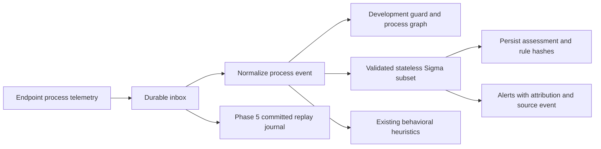

# Phase 6: constrained Sigma integration and honest heuristic naming

Implementation date: 2026-10-23. Code integration is implemented; empirical
calibration and Windows lab validation remain open. This is not full Sigma
compatibility, a trained model, or a measured improvement in malware recall.

## Architecture

The catalog loads once at startup, before starting the worker. An invalid or
empty catalog fails startup. Catalog changes require restart. Runtime matching
uses local literal comparisons, never expression execution or downloaded code.
Existing authenticated telemetry evidence routes return the `sigma` assessment.
Alert reasons display rule ID, title, author, license and exact file SHA256.
Missing fields are recorded and cannot match. Severity scores (50/70/90) are
ordinal routing values, not probabilities or calibrated confidence.

## Supported contract

- Windows `process_creation` only, including normalized ETW process creation.
- One named mapping selection; all fields must match.
- `Image` maps to `exe_path`, `CommandLine` to `cmdline`, `ParentImage` to
  `parent_exe_path`. Sysmon now supplies ParentImage through normalization;
  other sources may lack it. Neither shipped rule requires it.
- Case-insensitive literal equality, contains, startswith, endswith.
- Lists mean OR; `contains|all` requires every listed value.
- Wildcards, regex, null tests, aggregation, correlation, multiple selections,
  Boolean conditions and all other modifiers are rejected explicitly.

This adapter does not install pySigma. pySigma is a parsing/conversion toolkit,
not an in-process event matching engine. Full SigmaHQ import is deferred until
needed constructs, source provenance, license requirements and tests are reviewed.
See https://github.com/SigmaHQ/pySigma and
https://github.com/SigmaHQ/sigma-specification for upstream projects.

## Rule provenance and limitations

Two original BehEDR rules are supplied under the adjacent MIT license; neither
is represented as a copied or validated SigmaHQ rule:

| Rule | Required observations | Benign look-alike |
|---|---|---|
| Vssadmin Shadow Copy Deletion Request | vssadmin image plus delete and shadows command text | Administrator recovery cleanup |
| Bcdedit Recovery Disabled | bcdedit image plus /set, recoveryenabled and no | Authorized boot maintenance |

These are command-text signatures. They do not establish command success,
intent, ransomware presence or comprehensive recovery inhibition coverage.
Substring matching has false positives and bypasses; missing command lines,
renamed binaries, alternate utilities and argument obfuscation can evade them.
The benign negative tests cover list/enum operations, not all benign activity.
An authorized deletion intentionally matches and needs operator adjudication.
No automatic response is attached to these matches.

Catalog lives under `backend/server/sigma_rules`, outside the stateful recovery
rules folder. Phase 5 fingerprint and replay semantics are unchanged. Replay
rebuilds state without emitting these stateless alerts; old telemetry is not
retroactively evaluated. Each newly processed event records catalog hashes,
including no-match events. A fresh Docker image build and deployment checks
were performed during the follow-up review; see [closeout](../evidence/phase6-closeout.md).

`sequence_ml.py` is renamed to `sequence_heuristics.py`, with its active import
updated. Its counting/scoring logic is unchanged; no new ML capability is claimed.
Inactive historical experiments remain preserved rather than deleted without
an individual dependency and provenance review.

## Validation and remaining acceptance gates

Tests cover positive/negative rules, case folding, missing image, unsupported
modifiers and expressions, malicious YAML tags, duplicate IDs, atomic catalog
load failure, ingestion evidence and inbox retry deduplication.

Executed on 2026-10-23: focused suite **19 passed**; complete regression suite
**135 passed in 65.25 seconds**; Ruff checks passed. Tests used isolated temporary
databases. These results establish regression behavior, not detection accuracy.

Before claiming Phase 6 empirically complete:

1. In the disposable Windows VMware lab, collect labeled maintenance, build,
   installer, backup and browser workloads. Do not run recovery-disabling
   commands on the host or on a VM without a tested snapshot restoration path.
2. Collect authorized recovery-inhibition emulation separately; verify the
   operation independently of detector output. Synthetic events only test code.
3. Split tuning and held-out traces by scenario/time. Freeze the catalog hashes
   before held-out runs; retain host, collector configuration and ground truth.
4. Compare existing detector versus detector plus these rules on identical
   telemetry. Adjudicate benign matches; report recall, precision, benign
   alerts/endpoint-day, delay and collector loss with denominators.
5. Review every proposed suppression against held-out malicious cases; do not
   broadly allow-list administrator or development-tool descendants.
6. Rebuild the Docker image and run deployment smoke tests. Independently review
   upstream rules/licenses before expanding the catalog. Broader workloads and
   external baselines belong to the Phase 7 evaluation.

No accuracy numbers, novelty claim or publication-readiness score is supplied
because those require actual experiments.
