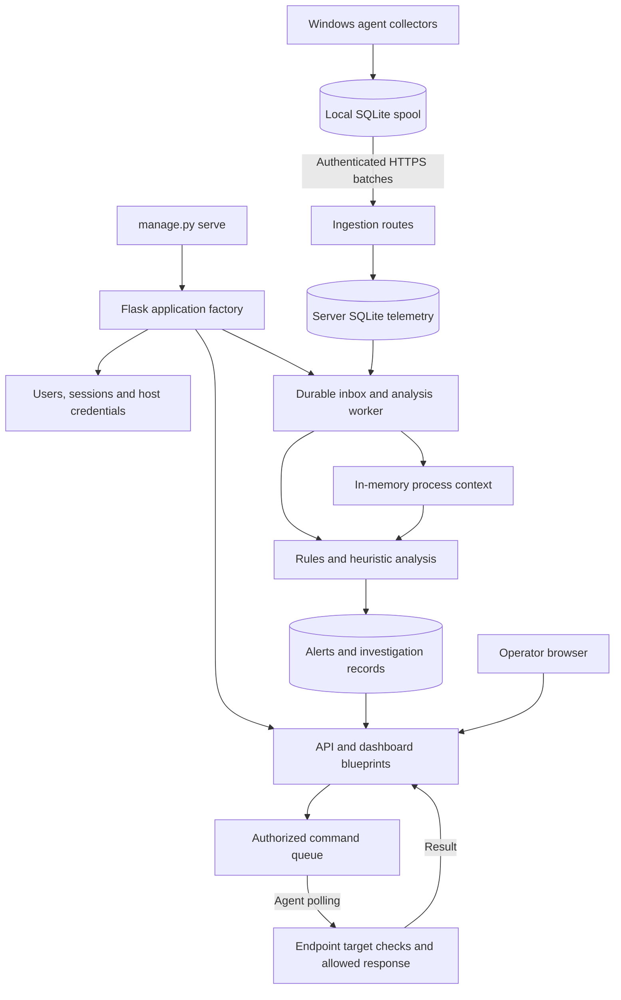

# BehEDR — Current Folder and Codebase Analysis

**Inspection date:** 16 October 2026  
**Root:** `C:\projects\newmalware`  
**Type:** Current source inventory, implementation assessment and improvement backlog.  
**Changes made:** This Markdown report only; no application fixes, collector execution or deployment.

## 1. Scope, evidence and main conclusion

The folder contains a Windows endpoint behavioral-monitoring prototype, a Python/Flask server, SQLite persistence, a browser dashboard, rules, tests, deployment configuration, research documents and preserved original implementations.

Useful engineering foundations exist, but malware accuracy and production readiness remain unproven. Current source still contains previously identified correctness and security gaps. File presence, comments claiming advanced functionality, and a passing syntax/lint check do not establish active or effective protection.

This inspection enumerated maintained-source/configuration/documentation paths, parsed their Python syntax, inspected startup wiring and important collection/authentication/ingestion/detection/deployment code, ran the configured Ruff checks and read the malware hash table count without modifying it. It is not a fresh exhaustive line-by-line audit of every file, penetration test, live malware benchmark or UI acceptance test.

Excluded from recursive source inventory: `.venv`, runtime `var`, Python/linter/test caches and database/log contents. `archive` is recorded as retained reference code rather than re-audited deployed code. Editor/agent metadata is listed by filename; its content is not treated as evidence of implemented features. No environment secrets or user credentials are reproduced.

## 2. Fresh verification results

- Inventoried source/configuration/documentation files: **98**, excluding this generated report.
- Python files parsed: **60**; parse failures: **0**.
- Configured Ruff command: `.venv/Scripts/python.exe -m ruff check --no-cache backend endpoint manage.py tests` → **passed**.
- Ruff configuration only selects `E9`, `F63`, `F7`, `F82`; this is a narrow correctness ruleset, not a broad style/security assessment.
- Fresh read-only hash-table inspection: **0 malware-hash rows**. This says nothing about independent IOC/YARA sources.
- Earlier review: **63 pytest cases passed in 30.33 seconds**. The full suite was **not rerun in this documentation turn**. Test function counts below can differ from pytest case counts because of parametrization.
- Syntax warning: `backend/server/core/uba.py:369` — `invalid escape sequence '\S'`. Correct the string escaping and add a focused check if behavior changes.

Inventory fingerprint (SHA-256 over sorted relative paths and file hashes): `baf09af1050f4dff7f3844d3a20599b85ad5e45cbcef1ada1e2d027547f65eb9`. This identifies this inventory, not a signed release or Git commit.

## 3. Top-level folder map

| Path | Current purpose | Improvement |
|---|---|---|
| `backend/server` | API, identity, storage, detection and browser console | Split large modules by responsibility after regression coverage; expose optional capability health |
| `backend/data` | Separate hash-intelligence runtime state | Move under configured runtime directory; stop import-time hidden database creation |
| `endpoint` | Windows sensors, spool, service and guarded command execution | Validate live coverage, permissions, reconnect and loss reporting |
| `rules` | YAML detection configuration, optional YARA directory, development policy | Version/validate rules; document false positives and expected inputs |
| `tests` | Isolated API, security, ingestion and endpoint regressions | Add missing cases and Windows end-to-end coverage |
| `requirements` | Server/development locks and endpoint dependencies | Reproducible endpoint lock/constraints and broader dependency review |
| `deploy` | Container, Compose and TLS reverse proxy | Validate real install, data permissions, readiness and restore |
| `tools` | Dependency-lock maintenance utility | Document provenance and reproducible lock generation |
| `.github` | Windows/Linux CI definition | Add integration/security checks incrementally; verify actual hosted runs |
| `docs` | Operations, historical verification, research and review evidence | Date evidence and avoid confusing historical results with current validation |
| `archive` | `edr_clean` and `edr-server` originals | Keep outside runtime/import/build paths; do not delete before backup/provenance review |
| `var` | Runtime/test state | Retention, backups, restricted ACLs, and clear separation of lab/live state |
| `.venv` | Local dependency installation | Recreate from declared dependencies; do not ship it |
| `__pycache__`, `.pytest_cache`, `.ruff_cache` | Generated caches | Keep excluded from source/build artifacts |
| `.kiro`, `.vscode` | Planning/editor metadata | Do not confuse planned requirements with delivered capabilities |
| Root Markdown files | Overview, master plan and research dossier | Use this report for current code facts; master plan for proposed work |
| `manage.py` | Initialization, users, enrollment, backup and single-process serving | Test backup restore and configuration compatibility |
| `.env.example` | Configuration template | Use placeholders; never embed real secrets in documentation |

The root listing did not show a `.env` file or `.git` entry. This alone does not establish the state of externally supplied environment variables or a parent Git repository.

### Enumerated maintained files

The inventory below is generated from the actual folder. Generated/runtime and archived contents are summarized above rather than expanded.

```text
C:\projects\newmalware\
  .dockerignore
  .env.example
  .github/workflows/ci.yml
  .gitignore
  .kiro/specs/edr-advanced-detection-engine/.config.kiro
  .kiro/specs/edr-advanced-detection-engine/requirements.md
  .vscode/settings.json
  backend/server/__init__.py
  backend/server/alert_storm_protection.py
  backend/server/auth.py
  backend/server/backup_manager.py
  backend/server/commands.py
  backend/server/config.py
  backend/server/core/__init__.py
  backend/server/core/active_learning.py
  backend/server/core/baseline_autoencoder.py
  backend/server/core/deep_sequence.py
  backend/server/core/detector.py
  backend/server/core/development_guard.py
  backend/server/core/dll_monitor.py
  backend/server/core/explainable_ai.py
  backend/server/core/graph.py
  backend/server/core/graph_ml.py
  backend/server/core/hash_db.py
  backend/server/core/lateral_movement.py
  backend/server/core/memory_forensics.py
  backend/server/core/predictive_scoring.py
  backend/server/core/processor.py
  backend/server/core/sequence_ml.py
  backend/server/core/threat_intel_enhanced.py
  backend/server/core/uba.py
  backend/server/core/yara_engine.py
  backend/server/database/__init__.py
  backend/server/database/incidents.py
  backend/server/database/storage.py
  backend/server/email_digest.py
  backend/server/health_monitor.py
  backend/server/ingestion.py
  backend/server/notifier.py
  backend/server/password_policy.py
  backend/server/playbooks.py
  backend/server/ratelimit.py
  backend/server/routes/__init__.py
  backend/server/routes/api.py
  backend/server/routes/dashboard.py
  backend/server/runtime_lock.py
  backend/server/static/dashboard.css
  backend/server/static/dashboard.js
  backend/server/templates/dashboard.html
  backend/server/threat_enrichment.py
  backend/server/threatintel.py
  backend/server/wazuh_bridge.py
  deploy/Caddyfile
  deploy/compose.yaml
  deploy/Dockerfile
  docs/dependency-audit.json
  docs/development-tool-monitoring.md
  docs/evaluation-2026-10-16.md
  docs/implementation.md
  docs/migration.md
  docs/operations.md
  docs/phase-1-research-2026-10-16.md
  docs/verification.md
  endpoint/agent.py
  endpoint/agent_service.py
  endpoint/etw_consumer.py
  endpoint/eventlog.py
  endpoint/process_context.py
  endpoint/response.py
  endpoint/spool.py
  endpoint/yara_scanner.py
  manage.py
  PROJECT_MASTER_PLAN.md
  pyproject.toml
  README.md
  requirements/dev.lock
  requirements/dev.txt
  requirements/endpoint.txt
  requirements/server.lock
  requirements/server.txt
  RESEARCH_DOSSIER.md
  rules/behaviour_chains.yaml
  rules/development_policy.json
  rules/heuristic_weights.yaml
  rules/lolbins_extended.yaml
  rules/mitre_mapping.yaml
  rules/parent_child_analysis.yaml
  rules/safe_processes.yaml
  rules/yara/README.md
  tests/conftest.py
  tests/preview_fixture.py
  tests/test_commands.py
  tests/test_development_guard.py
  tests/test_endpoint.py
  tests/test_ingestion.py
  tests/test_regressions.py
  tests/test_security.py
  tools/lock_dependencies.py
```

## 4. Current execution architecture



`create_app` initializes storage, authentication, inbox, detector, development policy and IOC loading, then registers only API and dashboard blueprints. It starts the analysis worker when background processing is enabled. `manage.py serve` enforces a single-instance lock and uses Waitress.

A durable ingestion acknowledgement means accepted storage, not completed analysis. Source occurrence time differs from arrival time; current network/file windows still use processing time. Graph/context persistence and duplicate processing effects need additional work. This is a single-process design; adding application workers is not a safe scaling change without shared-state redesign.

## 5. What is currently implemented

| Area | Existing behavior | Current qualification |
|---|---|---|
| Operator authentication | Scrypt passwords, JWT issuer/audience/version checks, role checks, cookie and CSRF controls | Important account recreation flaw remains |
| Endpoint identity | Per-host credential enrollment, rotation and revocation | Does not attest hardware or guarantee truthful telemetry |
| Ingestion | Event-type validation, bounded batches, durable inbox and stable event identity | Timing/attribution/recovery effects require testing |
| Process collection | Polling and conditional Windows event paths | Polling and provider gaps can miss activity |
| Network/file/DLL collection | Observations routed to server behavior checks | File-writer identity may be unknown; IPv6/Win32 concerns remain |
| Detection | Rule chains, command lines, process relationships, masquerading, network/file/DLL signals and lightweight sequence logic | Heuristics; not demonstrated malware probabilities |
| Supplemental intelligence | IOC loading, hash lookup path, conditional enhanced feed and YARA support | Hash DB empty; fail-silent optional paths need observability |
| Investigation UI | Alerts, event/incident queries, graph, feedback, analysis failures and audit paths | Current visual/end-to-end behavior not exercised in this turn |
| Response | Analyst read commands; administrator-only guarded process termination | Requires identity checks; replay/restore namespace needs correction |
| Backup | CLI SQLite backup plus integrity check | A backup check is not a full application restore drill |
| Deployment | TLS proxy/Compose, non-root container and persistent server volume | Hash DB currently points outside that volume |
| Development-tool context | Optional policy/ancestry assessment | Empty workspace/approval policy; not an OS sandbox |

### Disabled, conditional or reference code

`EXPERIMENTAL_ML` defaults false and configuration rejects true. LSTM/GNN/autoencoder modules therefore are not supported active capabilities. The current API reports automatic response, network isolation, experimental models and notifications as unavailable.

The presence of `wazuh_bridge.py`, `notifier.py`, `email_digest.py` or `playbooks.py` does not establish that their routes/jobs are wired into the active application. UBA, memory-forensics and active-learning files similarly do not establish validated integration.

Do not label every optional module unused: detector code attempts enhanced threat-intelligence lookup and predictive/explanation hooks, and lightweight sequence logic is recorded. These are conditional/best-effort paths rather than validated product claims. Review actual imports, gates and initialization before relocating them.

## 6. Code and module inventory

This table is AST-generated. It lists module size, declared classes/top-level functions and representative symbols; it is a navigation aid, not proof every symbol executes. Empty package initializers are normal.

| Python file | Lines | Top-level functions / classes | Representative symbols |
|---|---:|---:|---|
| `backend/server/__init__.py` | 60 | 1 | create_app |
| `backend/server/alert_storm_protection.py` | 196 | 7 | check_alert_storm, _clean_old_entries, _get_rate, _enter_storm, _exit_storm, get_storm_status, reset_storm |
| `backend/server/auth.py` | 152 | 11 | init_auth, get_users, create_user, delete_user, authenticate, _decode_jwt, revoke_sessions, require_jwt … |
| `backend/server/backup_manager.py` | 417 | 10 | create_backup, _verify_backup, restore_backup, _cleanup_old_backups, _backup_loop, start_backup_scheduler, stop_backup_scheduler, get_backup_status … |
| `backend/server/commands.py` | 27 | 1 | validate_command |
| `backend/server/config.py` | 330 | 1 | validate_configuration |
| `backend/server/core/__init__.py` | 1 | 0 | Package/module declarations |
| `backend/server/core/active_learning.py` | 401 | 10 | record_feedback, get_feedback, get_all_feedback, get_stats, _adjust_detection_weights, _maybe_retrain, _retrain_with_feedback, get_suppression_suggestions … |
| `backend/server/core/baseline_autoencoder.py` | 604 | 10 | extract_behavioral_features, compute_baseline_stats, train_baseline_model, load_baseline_model, record_baseline_event, detect_baseline_anomaly, initialize, is_available … |
| `backend/server/core/deep_sequence.py` | 472 | 10 | ProcessTokenizer, extract_sequence_features, build_lstm_model_tf, train_lstm_model, load_persisted_lstm_model, record_sequence_event, detect_sequence_anomaly, initialize … |
| `backend/server/core/detector.py` | 1678 | 34 | _can_auto_kill, _prune_auto_kill_dict, _load_yaml, load_rules, _severity, _make_alert, _emit, _l0a_hash_check … |
| `backend/server/core/development_guard.py` | 84 | 3 | load_policy, within, evaluate |
| `backend/server/core/dll_monitor.py` | 159 | 3 | add_dll_event, check_dll_hijacking, get_dll_stats |
| `backend/server/core/explainable_ai.py` | 593 | 12 | explain_features, _calculate_weight, _explain_ml_decision, find_similar_incidents, get_recommended_actions, get_risk_context, _get_mitre_info, explain_alert … |
| `backend/server/core/graph.py` | 55 | 4 | add_event, rebuild_from_db, get_chains, to_json |
| `backend/server/core/graph_ml.py` | 583 | 10 | build_process_graph, extract_graph_features, _jaccard_similarity, train_gnn_model, load_persisted_gnn_model, record_graph_event, detect_graph_anomaly, initialize … |
| `backend/server/core/hash_db.py` | 540 | 10 | _get_conn, init_hash_db, check_hash, add_hash, download_malwarebazaar_hashes, download_urlhaus_hashes, download_threatfox_iocs, update_hash_db … |
| `backend/server/core/lateral_movement.py` | 631 | 12 | record_lateral_event, record_network_connection, detect_psexec_lateral_movement, detect_pass_the_hash, detect_kerberos_abuse, detect_wmi_lateral_movement, detect_powershell_remoting, detect_rdp_chaining … |
| `backend/server/core/memory_forensics.py` | 501 | 12 | add_memory_event, _prune_memory_events, detect_reflective_dll, record_process_creation, detect_process_hollowing, detect_code_cave, detect_powershell_hijack, detect_remote_thread_injection … |
| `backend/server/core/predictive_scoring.py` | 394 | 10 | classify_stage, record_stage, _predict_next_stage, get_prediction, _get_recommendations, get_all_chains, get_system_chain, clear_chain … |
| `backend/server/core/processor.py` | 95 | 4 | valid_system_id, normalize, validate, process |
| `backend/server/core/sequence_ml.py` | 216 | 4 | record_event, score_frequency, score_sequence, get_stats |
| `backend/server/core/threat_intel_enhanced.py` | 526 | 12 | _fetch_alienvault_otx, _fetch_abusech_urlhaus, _fetch_abusech_malwarebazaar, _fetch_abusech_threatfox, _fetch_greynoise, _load_cache, _save_cache, _update_feeds … |
| `backend/server/core/uba.py` | 550 | 18 | UserProfile, get_user_profile, _prune_old_profiles, record_login, record_app_usage, record_network_access, record_file_access, record_privilege_escalation … |
| `backend/server/core/yara_engine.py` | 584 | 15 | is_available, ensure_rules_dir, download_rule_packs, compile_rules, load_compiled_rules, _get_rules, _cache_get, _cache_set … |
| `backend/server/database/__init__.py` | 1 | 0 | Package/module declarations |
| `backend/server/database/incidents.py` | 164 | 8 | _severity_rank, correlate_alert, _make_title, get_incidents, get_incident, update_incident_status, get_incident_alerts, incident_stats |
| `backend/server/database/storage.py` | 627 | 36 | _get_pooled_conn, _return_to_pool, _create_connection, _conn, close_thread_connection, _execute_write, init_db, save_event … |
| `backend/server/email_digest.py` | 370 | 7 | get_daily_stats, format_html_email, send_digest_email, should_send_now, digest_loop, start_digest_scheduler, send_test_digest |
| `backend/server/health_monitor.py` | 274 | 10 | record_agent_heartbeat, _check_agent_health, _check_server_health, _health_check_loop, start_health_monitor, stop_health_monitor, get_health_status, _notify_agent_offline … |
| `backend/server/ingestion.py` | 169 | 7 | init_inbox, validate_event, accept, analyze_telemetry, process_one, start_worker, backlog |
| `backend/server/notifier.py` | 507 | 15 | _rank, _is_duplicate, _ts_human, _level_emoji, _short_reason, _send_slack, _send_teams, _send_email … |
| `backend/server/password_policy.py` | 195 | 9 | _load_password_history, _save_password_history, _hash_password, validate_password_strength, check_password_history, record_password_change, is_default_password, get_password_policy … |
| `backend/server/playbooks.py` | 424 | 10 | _on_cooldown, _load_custom_playbooks, _get_playbooks, _matches, _resolve_params, _check_condition, _execute_playbook, run_playbooks … |
| `backend/server/ratelimit.py` | 133 | 4 | _check, rate_limit, rate_limit_agent, _evict |
| `backend/server/routes/__init__.py` | 1 | 0 | Package/module declarations |
| `backend/server/routes/api.py` | 315 | 31 | body, limit, login, me, logout, users, add_user, delete_user … |
| `backend/server/routes/dashboard.py` | 15 | 2 | index, favicon |
| `backend/server/runtime_lock.py` | 27 | 1 | exclusive_instance |
| `backend/server/threat_enrichment.py` | 457 | 10 | _cache_get, _cache_set, enrich_virustotal, enrich_otx, enrich_abusech, enrich_shodan, enrich_misp, enrich_alert … |
| `backend/server/threatintel.py` | 235 | 11 | _build_index, load_iocs, _save_iocs, add_ioc, _default_iocs, _refresh_loop, check_ioc, _hit … |
| `backend/server/wazuh_bridge.py` | 331 | 6 | _normalize_sysmon, _basename, _pipeline, wazuh_events, wazuh_health, SyslogReceiver |
| `endpoint/agent.py` | 907 | 30 | _pid_is_new, _seed_baseline, _post, _get, _parent_name, _parent_created, _cmdline, _sha256_of … |
| `endpoint/agent_service.py` | 34 | 1 | BehEDRAgentService |
| `endpoint/etw_consumer.py` | 847 | 13 | _ts, _push, _find_silketw, _parse_silketw_record, _proc_name_for_pid, _tail_file, _run_silketw_backend, _wevtutil_query … |
| `endpoint/eventlog.py` | 25 | 1 | parse_xml |
| `endpoint/process_context.py` | 28 | 1 | capture |
| `endpoint/response.py` | 41 | 1 | execute |
| `endpoint/spool.py` | 81 | 1 | Spool |
| `endpoint/yara_scanner.py` | 727 | 11 | MEMORY_BASIC_INFORMATION, _open_process, _close_handle, _get_suspicious_regions, _read_region, _build_ruleset, _scan_process, _push_hit … |
| `manage.py` | 81 | 2 | load_environment, main |
| `tests/conftest.py` | 65 | 6 | app, clean_database, client, agent_headers, event, admin_headers |
| `tests/preview_fixture.py` | 30 | 0 | Package/module declarations |
| `tests/test_commands.py` | 38 | 4 | test_command_poll_ownership_and_lease, test_unsafe_commands_rejected, test_viewer_cannot_command, test_expired_command_never_delivered |
| `tests/test_development_guard.py` | 126 | 11 | coding_event, test_normal_build_no_new_alert, test_intent_rules, test_missing_ancestry_does_not_invent_attribution, test_workspace_boundary_and_approval, test_approval_cannot_hide_sensitive_behavior, test_invalid_ancestry_rejected, test_assessment_persisted_and_exposed … |
| `tests/test_endpoint.py` | 86 | 7 | test_spool_survives_reopen_and_ack, test_command_executes_once_across_restart, test_spool_capacity_and_rejected_record, test_kill_refuses_reused_pid, test_kill_checks_hash, test_eventlog_xml, test_no_entity_expansion |
| `tests/test_ingestion.py` | 58 | 6 | test_durable_idempotent_ingestion, test_bad_events_are_rejected_atomically, test_same_second_different_pid_survives, test_retry_visible_after_failure, test_rule_requires_parent, test_first_alert_not_a_storm |
| `tests/test_regressions.py` | 119 | 11 | test_batch_capacity_returns_retry, test_concurrent_acceptance_and_recovery, test_graph_does_not_join_same_name_instances, test_heartbeat_preserves_registration, test_sse_independent_cursors, test_dll_and_file_events_trigger_without_process, test_literal_signature_path, test_wevtutil_uses_xml_and_record_cursor … |
| `tests/test_security.py` | 54 | 7 | test_no_default_user, test_cookie_csrf_and_logout, test_agent_host_binding_and_revocation, test_rotation_invalidates_old_key, test_deleted_user_token_invalid, test_malformed_login, test_dashboard_has_no_shared_secret |
| `tools/lock_dependencies.py` | 31 | 1 | lock |

### Maintainability priorities

Large modules combine concerns. Refactor `detector.py` into signal evaluators, correlation/state, scoring and evidence output; `agent.py` into collection and transport lifecycle; and storage into migrations, telemetry and command persistence. Preserve behavior with tests before moving code. An existing architectural flaw is not repaired just by changing filenames.

Avoid importing optional modules merely to discover their status when imports create directories, databases or threads. Use explicit initialization and capability reporting. Replace silent broad exception handling with bounded diagnostic logging and health state while retaining safe degraded operation.

Configuration contains older comments and broad process allowlists. The configuration alone does not prove an active bypass; trace each use before deciding whether it suppresses analysis. Avoid blanket trust in IDE, Node or Python ancestry, particularly for AI-assisted development.

## 7. API and access-control surface

Source-declared route inventory follows. Decorators describe intended controls and require runtime tests. Dynamically registered telemetry paths are listed separately.

| Method | Route | Handler | Decorators |
|---|---|---|---|
| POST | `/auth/login` | `login` | `rate_limit('login', per_minute=10)` |
| GET | `/auth/me` | `me` | `auth.require_jwt()` |
| POST | `/auth/logout` | `logout` | `auth.require_jwt()` |
| GET | `/auth/users` | `users` | `auth.require_jwt('admin')` |
| POST | `/auth/users` | `add_user` | `auth.require_jwt('admin')` |
| DELETE | `/auth/users/<username>` | `delete_user` | `auth.require_jwt('admin')` |
| POST | `/api/agents/enroll` | `enroll` | `auth.require_jwt('admin')` |
| DELETE | `/api/agents/<system_id>/credential` | `revoke` | `auth.require_jwt('admin')` |
| POST | `/register` | `register` | `auth.require_agent_key` |
| POST | `/heartbeat` | `heartbeat` | `auth.require_agent_key` |
| GET | `/commands/<system_id>` | `commands` | `auth.require_agent_key` |
| POST | `/commands/result` | `command_result` | `auth.require_agent_key` |
| POST | `/api/command` | `command` | `auth.require_jwt('analyst'); rate_limit('command', per_minute=30)` |
| GET | `/api/commands` | `command_history` | `auth.require_jwt('analyst')` |
| GET | `/api/status` | `status` | `auth.require_jwt()` |
| GET | `/api/events` | `events` | `auth.require_jwt()` |
| GET | `/api/alerts` | `alerts` | `auth.require_jwt()` |
| GET | `/api/alerts/<int:alert_id>` | `alert_detail` | `auth.require_jwt()` |
| GET | `/api/audit` | `audit` | `auth.require_jwt('admin')` |
| GET | `/api/incidents` | `incidents` | `auth.require_jwt()` |
| POST | `/api/incidents/<int:incident_id>/status` | `incident_status` | `auth.require_jwt('analyst')` |
| GET | `/api/graph/<system_id>` | `graph` | `auth.require_jwt()` |
| POST | `/api/alerts/<int:alert_id>/feedback` | `feedback` | `auth.require_jwt('analyst')` |
| GET | `/api/analysis/failures` | `failures` | `auth.require_jwt('admin')` |
| POST | `/api/analysis/<int:job_id>/retry` | `retry` | `auth.require_jwt('admin')` |
| GET | `/health` | `health` | `` |
| GET | `/ready` | `ready` | `` |
| GET | `/stream` | `stream` | `auth.require_jwt()` |

Dynamic POST ingestion paths: `/events`, `/dll_events`, `/net_events`, `/file_events`, `/etw_events`, `/yara_hits`. They share authenticated ingestion handling.

Required improvements: test host binding for nested batches, role checks per mutation, consistent error contracts, ambiguous “processed” versus “accepted” responses, hostile evidence rendering and rate-limit behavior behind the configured proxy. The `processed` response field currently counts accepted IDs; it should not be interpreted as completed worker analysis.

## 8. Current test inventory and missing coverage

| Test file | Declared test functions | Names |
|---|---:|---|
| `test_commands.py` | 4 | `test_command_poll_ownership_and_lease`, `test_unsafe_commands_rejected`, `test_viewer_cannot_command`, `test_expired_command_never_delivered` |
| `test_development_guard.py` | 10 | `test_normal_build_no_new_alert`, `test_intent_rules`, `test_missing_ancestry_does_not_invent_attribution`, `test_workspace_boundary_and_approval`, `test_approval_cannot_hide_sensitive_behavior`, `test_invalid_ancestry_rejected`, `test_assessment_persisted_and_exposed`, `test_invalid_policy_fails_closed`, `test_collector_marks_access_denied`, `test_collector_bounds_ancestry` |
| `test_endpoint.py` | 7 | `test_spool_survives_reopen_and_ack`, `test_command_executes_once_across_restart`, `test_spool_capacity_and_rejected_record`, `test_kill_refuses_reused_pid`, `test_kill_checks_hash`, `test_eventlog_xml`, `test_no_entity_expansion` |
| `test_ingestion.py` | 6 | `test_durable_idempotent_ingestion`, `test_bad_events_are_rejected_atomically`, `test_same_second_different_pid_survives`, `test_retry_visible_after_failure`, `test_rule_requires_parent`, `test_first_alert_not_a_storm` |
| `test_regressions.py` | 11 | `test_batch_capacity_returns_retry`, `test_concurrent_acceptance_and_recovery`, `test_graph_does_not_join_same_name_instances`, `test_heartbeat_preserves_registration`, `test_sse_independent_cursors`, `test_dll_and_file_events_trigger_without_process`, `test_literal_signature_path`, `test_wevtutil_uses_xml_and_record_cursor`, `test_configuration_rejects_missing_secret`, `test_single_instance_lock`, `test_backup_preserves_wal_commits` |
| `test_security.py` | 7 | `test_no_default_user`, `test_cookie_csrf_and_logout`, `test_agent_host_binding_and_revocation`, `test_rotation_invalidates_old_key`, `test_deleted_user_token_invalid`, `test_malformed_login`, `test_dashboard_has_no_shared_secret` |

`conftest.py` creates isolated databases/test configuration. `preview_fixture.py` is fixture support, not proof the live product emits fake data. Historical verification must be read with its date and limits.

Missing or insufficient evidence:

- Account deletion/recreation token lifecycle and restored command-ID collisions.
- Batched benign connections, normal README activity and distinct process attribution.
- Windows service/collector end-to-end behavior, short-lived processes, log resets and IPv6.
- Duplicate contribution after worker crash, restart reconstruction, queue overflow and disk exhaustion.
- Dashboard browser workflows, hostile text rendering and integrated authorization.
- Real container start, writable paths, TLS, backup/restore and upgrade/rollback.
- Labeled malware and realistic benign workloads with independent ground truth.
- Performance, alert burden and sustained operational measurements.

CI currently defines Linux/Windows Python 3.12 jobs running Ruff, pytest and an audit of `requirements/server.lock`. No hosted results were verified in this turn. The pipeline does not by itself establish endpoint-dependency coverage, live collector behavior, UI security, artifact signing or deployment qualification.

## 9. Prioritized improvements

| ID | Priority | Source / issue | Change | Required acceptance test |
|---|---|---|---|---|
| C01 | High | `auth.py`: username recreation resets session version | Non-repeating account/session identity | Old token rejected after delete/recreate; new login valid |
| C02 | High | `detector.py`: network timestamps and name grouping | Source-time, process-instance and destination-aware windows | Identical benign trace sent in different batches does not invent C2 |
| C03 | High | `detector.py`: filename-only ransom wording, unknown writer | Independent corroboration and explicit attribution gaps | README/build/backup look-alikes and genuine labeled patterns |
| C04 | High | Endpoint collection: bookmarks, IPv6, queue and API declarations | Reliable collection and visible loss/health | 64-bit Windows known-action capture, restart and overflow |
| C05 | High | `hash_db.py`: empty database and backend/data path | Configured persistence and explicit feed health | Read-only container plus writable data volume; missing/stale feed states |
| C06 | Medium | Worker/context restart and repeated effects | Documented durable recovery/idempotency | Crash at commit/analysis boundaries and duplicate replay |
| C07 | Medium | Broad alert deduplication | Preserve distinct instance evidence | Concurrent same-name processes produce distinguishable incidents |
| C08 | Medium | `spool.py`: integer command result identity | Global command identity/server generation | Restore/replacement does not confuse old and new commands |
| C09 | Medium | Optional hooks hide errors | Structured capability and degradation reporting | Missing dependency/feed fails visibly without breaking unrelated detection |
| C10 | Medium | Large modules and narrow lint | Test-led separation and progressive static checks | Behavior regressions unchanged; meaningful new checks pass |
| C11 | Medium | Retention, deployment and recovery unqualified | Operational limits, runbooks, restore/rollback | Sustained load, storage exhaustion and clean deployment |
| C12 | Research | No representative detection evaluation | Frozen datasets, fair baselines, independent labels | Recall/false-alert trade-off and uncertainty reproduced |

The session and benign-pattern failures were reproduced during the prior review; this turn rechecked relevant source, not those runtime probes. Container/hash-path and Win32 issues are code-level findings requiring deployment/runtime confirmation. These priorities are local judgments, not CVSS scores.

## 10. Folder-structure improvements without unnecessary rewrites

Keep the current top-level structure: it already separates server, endpoint, rules, tests, deployment and documents. Proposed incremental additions:

```text
backend/server/core/signals/      Focused detector evaluators after test coverage
backend/server/core/correlation/ Process identity, time windows and evidence state
backend/server/database/migrations/ Explicit schema evolution
endpoint/collectors/             Windows collection modules with shared event contract
tests/unit/                     Pure logic and boundary tests
tests/integration/              Database/API/spool interactions
tests/windows/                  Windows-only live collection tests
tests/security/                 Identity, authorization and hostile-input checks
research/protocols/              Frozen research questions and evaluation protocol
research/manifests/              Dataset provenance/splits, excluding private samples
research/configs/               Pinned comparator and experiment configuration
research/scripts/               Reproducible metrics and figures
```

These directories are suggestions, not created here. Move files only when responsibility and imports are understood. Separate inactive experiments with an explicit status/entry point rather than deleting them or advertising them as active. Keep archived originals out of runtime and build paths.

## 11. Recommended implementation order

1. Preserve an identifiable baseline and convert C01–C12 into tracked work.
2. Fix identity/session correctness and the demonstrated misleading detector results.
3. Repair collection time/identity coverage and expose losses.
4. Qualify inbox/spool recovery and response replay behavior.
5. Fix runtime paths/feed visibility and test deployment/restore.
6. Improve UI/investigation correctness and run scoped security tests.
7. Freeze a corrected simple baseline before implementing a research method.
8. Build the labeled evaluation, compare fairly, then conduct an alert-only pilot.
9. Refactor incrementally where it reduces risk; defer HA, automatic containment and new advanced models until justified.

For each change: requirement → code → regression/security test → evidence → documentation → release decision. Software checks and malware-effectiveness evaluation are separate gates.

## 12. Related project documents and status

- [PROJECT_MASTER_PLAN.md](C:/projects/newmalware/PROJECT_MASTER_PLAN.md): architecture/workflows and 13-phase SDLC; contains proposals, not proof of completion.
- [RESEARCH_DOSSIER.md](C:/projects/newmalware/RESEARCH_DOSSIER.md): consolidated research/comparisons and evidence gaps.
- [Code evaluation](C:/projects/newmalware/docs/evaluation-2026-10-16.md): prior isolated checks and feature assessment.
- [Research assessment](C:/projects/newmalware/docs/phase-1-research-2026-10-16.md): literature scope, hypotheses and protocol.
- [Operations](C:/projects/newmalware/docs/operations.md): setup and operating instructions, subject to current blockers.
- [Historical verification](C:/projects/newmalware/docs/verification.md): dated evidence; not current validation of every feature.

This report adds a current filesystem/source snapshot. It does not replace the distinction between implemented, disabled, conditional, proposed and experimentally validated features. No product code was modified.
