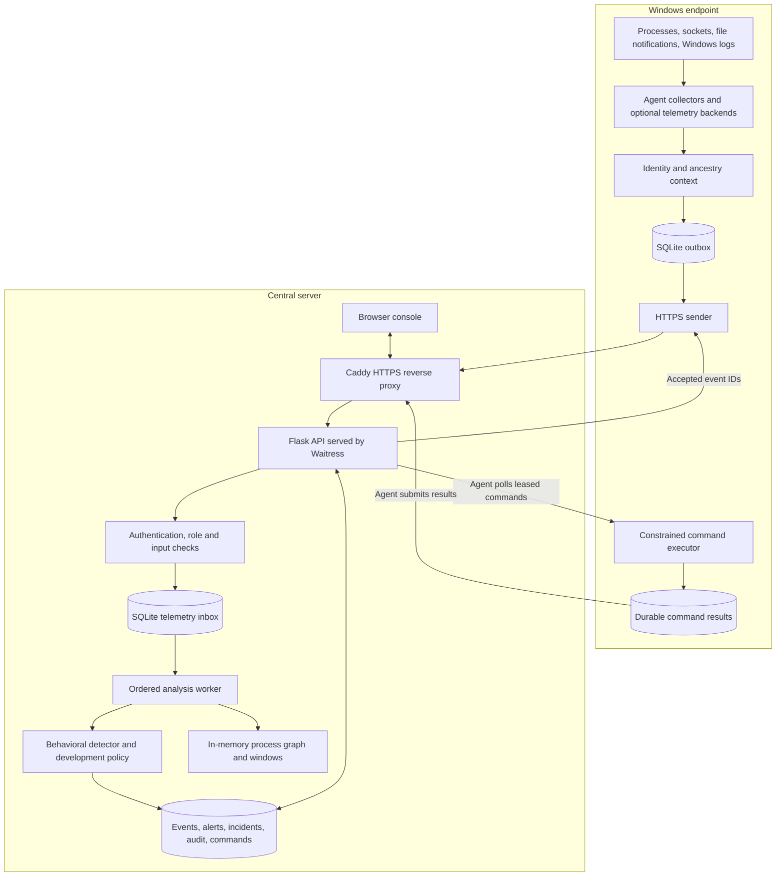
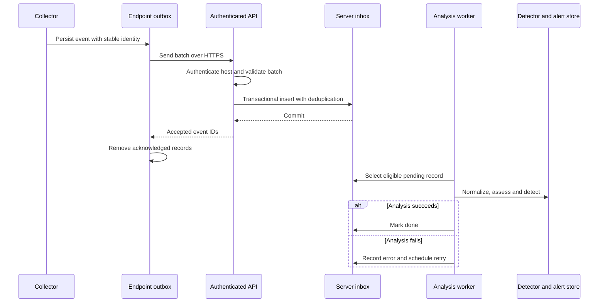
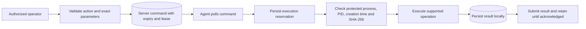

# BehEDR: Design and Implementation of a Windows Behavioral Threat Monitoring System

**Document type:** implementation-paper draft and technical project reference  
**Code snapshot reviewed:** 22 October 2026  
**Project location:** `C:\projects\newmalware`  
**Status:** research prototype / isolated pilot candidate, with unresolved validation and reliability work

## Abstract

BehEDR is a Windows endpoint telemetry and behavioral threat monitoring project. It collects process, network, file, and available Windows event-log observations, transports them through a persistent endpoint outbox, and accepts them into a durable server-side analysis inbox. A central Python service evaluates behavioral rules, parent–child relationships, command-line indicators, sequence patterns, process graphs, and contextual file and network activity. Alerts retain links to their source evidence and are available through an authenticated browser console. Constrained operator-requested endpoint actions use process-identity checks and durable execution-result handling. The implementation prioritizes inspectable evidence and explicit uncertainty over unsupported claims of perfect malware classification. Recent changes separate file scoring from collection, validate external thresholds, and reduce filename-only and duplicate-observation false positives. The latest recorded regression run passed 78 tests; this is software correctness evidence, not a malware-detection accuracy measurement. Real-world efficacy, collection completeness, operational scale, and research novelty remain to be demonstrated.

**Keywords:** behavioral malware detection; Windows telemetry; endpoint monitoring; process ancestry; rule-based detection; durable ingestion; explainable alerts.

## 1. Problem, objectives, and scope

Malicious activity can involve ordinary Windows utilities, script engines, or otherwise legitimate executables. BehEDR investigates observable behavior around those executions rather than relying exclusively on a file signature. Its engineering objectives are to collect useful evidence, preserve it across temporary transport failures, recognize suspicious patterns, explain findings to an analyst, and constrain remote response operations.

The current project is primarily a **behavioral detection and investigation system**. It also contains optional signature/IOC hooks. It is not a guaranteed malware verdict service, a sandbox that runs uploaded samples, a general antivirus replacement, or a proven autonomous prevention product. A suspicious pattern can be legitimate; a malicious action can evade the available telemetry or rules.

Development tools and AI coding tools are one relevant workload. Their descendants can execute sensitive operations, but supporting that workload does not change the core project topic to AI-agent security. Executable-name and ancestry hints do not establish whether a person or an AI authored a command.

### 1.1 Implemented versus demonstrated

| Category | Current interpretation |
|---|---|
| Implemented | Source contains an active route or execution path for the behavior |
| Regression-tested | Specific synthetic or mocked behavior is covered by the local tests |
| Optional | Requires extra dependencies, policy, telemetry source, or rules |
| Disabled / inherited | Files exist but are not supported active capabilities |
| Experimentally validated | Requires independently labelled workloads and measurements; not established by the existing test pass count |

This report describes the local source and recorded local checks. It is not a fresh literature review, independent penetration test, or completed journal manuscript. Statements in inherited comments such as “highest accuracy” are not experimental results.

## 2. Technology stack

Versions below are declarations from `requirements/*.txt`, not a claim that every target machine has those packages installed. Lock files provide the reproducible dependency inputs used by the documented setup.

| Technology | Declared version / form | Role |
|---|---|---|
| Python | 3.12 documented target | Agent, API, analysis, administration |
| Flask | 3.1.3 | Application factory and HTTP routes |
| Waitress | 3.0.2 | Single-process production WSGI serving |
| SQLite | Python standard-library interface | Telemetry, alerts, users, commands, local outbox |
| PyJWT | 2.15.0 | Signed dashboard sessions |
| Werkzeug | Flask dependency | Password hashing and HTTP utilities |
| PyYAML | 6.0.3 | Behavioral rule loading |
| NetworkX | 3.7 | In-memory process graph |
| NumPy | 2.5.3 | Numeric support in analysis modules |
| Requests | 2.34.2 | Endpoint/server HTTP clients |
| psutil | 7.2.2 | Process and network observations; constrained response |
| pywin32 | >=311 on Windows | Windows service/event-log integration |
| Windows APIs / ctypes | Platform interfaces | Directory-change notifications and platform collection |
| HTML, CSS, JavaScript | Local static assets | Browser console and evidence inspection |
| Docker Compose, Caddy | Deployment templates; `caddy:2` | Container configuration and HTTPS reverse proxy |
| pytest / Ruff / pip-audit | 9.1.1 / 0.16.9 / 2.10.1 | Tests, selected lint checks, available dependency-audit tooling |
| SilkETW | Optional external executable | Alternative telemetry collection backend |
| yara-python | Optional, separately installed | Endpoint scanning hooks requiring rules and validation |

There is no active requirement to operate Kafka, Elasticsearch, PostgreSQL, Kubernetes, or a GPU service. Adding those tools would be an architectural change rather than a description of the current implementation.

## 3. Repository organization

```text
newmalware/
├── manage.py                    # Administration and server launcher
├── backend/
│   ├── server/
│   │   ├── __init__.py           # App creation, startup validation, headers
│   │   ├── config.py            # Paths, limits, feature flags
│   │   ├── auth.py              # Users, JWT sessions, agent credentials
│   │   ├── ingestion.py         # Durable inbox, routing, retry worker
│   │   ├── commands.py          # Allowed remote-operation validation
│   │   ├── core/                # Detection, graph, policies, inherited models
│   │   ├── database/            # Persistent records and incident helpers
│   │   ├── routes/              # API and dashboard blueprints
│   │   ├── templates/           # Dashboard HTML
│   │   └── static/              # Dashboard JavaScript and CSS
│   └── data/                    # Legacy hash database location
├── endpoint/                    # Collectors, spool, response, service entry
├── rules/                       # YAML rules, JSON policies, optional YARA
├── requirements/                # Server, endpoint, development dependency sets
├── tests/                       # Isolated regression tests and fixtures
├── deploy/                      # Dockerfile, Compose, Caddyfile
├── tools/                       # Maintenance utilities
├── docs/                        # Operations, research, evaluation, integration
├── var/                         # Local runtime/test data; not source evidence
├── archive/                     # Original implementation snapshots
└── gthb/                        # Downloaded reference projects
```

`archive/`, `gthb/`, cached bytecode, and test outputs are not active deployed backend modules. Presence of a Python file under `core/` does not alone establish that it is enabled.

## 4. Architecture



### 4.1 Deployment location

The Windows agent runs on each monitored machine. The central server can be placed on an internal LAN host or a reachable cloud VM with HTTPS and appropriate access controls. LAN and cloud are deployment choices for the same central architecture; there is no separate cloud detection engine. The deployment templates package the server, not a Linux replacement for Windows endpoint collection.

Current analysis context is held in memory and the launcher uses an exclusive-instance lock. Use one server process. Multiple independent worker processes or horizontally scaled replicas would have inconsistent graph and correlation state without further design work. SQLite and one ordered worker are reasonable pilot building blocks but do not prove large-fleet capacity or high availability.

### 4.2 Trust boundaries

1. The endpoint observes OS activity and accesses local credentials and spool files.
2. The network separates endpoint telemetry from the central service; TLS validates the server.
3. Per-host credentials authenticate a reporting agent and bind reports to that host identity.
4. Dashboard sessions authorize human access and response requests.
5. Rule files and server configuration are privileged inputs maintained by administrators.

Authenticated telemetry is not necessarily truthful telemetry: an administrator-level endpoint compromise can interfere with the agent or its observations. The project does not implement tamper-proof kernel evidence or hardware attestation.

## 5. Endpoint implementation

`endpoint/agent.py` coordinates collection, sending, heartbeats, and command polling in background threads. `agent_service.py` provides a Windows-service entry point using the same lifecycle.

| Input | Implementation | Evidence and limits |
|---|---|---|
| Process activity | psutil polling and `_build_event` | Names, PID/PPID, creation times, path, command line, user, hash when accessible; short-lived processes may be missed |
| Process ancestry | `process_context.py` | Up to eight ancestors with identity/path and explicit completeness status; unavailable/exited parents remain uncertain |
| Network activity | psutil connection observations | Destination and process information where available; not packet contents or proof of exfiltration |
| Filesystem changes | Windows directory notifications | Paths and actions within watched locations; directory watchers do not establish the writer |
| DLL observations | Process module inspection / available image-load events | Context for suspicious DLL loading; availability and signature checks depend on platform permissions |
| Windows events | `eventlog.py`, `etw_consumer.py` | Available Security, PowerShell, System or sidecar events; audit policy and access determine coverage |
| YARA hits | `yara_scanner.py` | Optional scanning path; no validated comprehensive rule corpus is established here |

The optional SilkETW path and event-log fallback do not supply identical coverage. Security 4688 and PowerShell 4104 require suitable logging configuration. An accepted event type at the API does not prove that every endpoint can collect it.

### 5.1 Durable transport

`endpoint/spool.py` writes events to a SQLite WAL outbox with stable event IDs before delivery. The sender groups pending records by ingestion route. Only acknowledged IDs are removed. Rejected records retain an error, and unacknowledged records can be retried. The default outbox capacity is 100,000 records; exhaustion is reported rather than providing unlimited buffering.

This is retryable delivery with server deduplication, not a blanket exactly-once processing guarantee. In-memory collector queues, disk exhaustion, collector failures, and analysis crash boundaries still require loss/replay testing.

## 6. Event model and ingestion

Process records use `system_id`, `event_id`, `event`, `time`, `pid`, `ppid`, `create_time`, `parent_create_time`, `parent`, `child`, `cmdline`, `exe_path`, `sha256`, `user`, `cwd`, `ancestors`, and `ancestry_status`. Not every observation source supplies every optional field.

`core/processor.py` validates types, lengths, finite timestamps, host identifiers, hashes, bounded ancestry, and immediate-parent consistency. Nonprocess events have route-specific event-kind checks and bounded serialization. Missing actor identity must remain unknown rather than being inferred from a nearby process name.

| Ingestion route | Accepted family |
|---|---|
| `/events` | Process-spawn records |
| `/dll_events` | DLL-load observations |
| `/net_events` | Network connections |
| `/file_events` | File changes |
| `/etw_events` | Supported process, thread, image, network, registry, DNS, script, task, service and account events |
| `/yara_hits` | Endpoint-reported YARA matches |

The request body is limited to 2 MiB and batches to 200 events. The inbox has a unique `(system_id, event_id)` constraint. Batch acceptance commits atomically, and acknowledgement means accepted into storage—not necessarily analyzed successfully or found safe.



The worker processes eligible pending records in ID order. Failed records use bounded exponential delays; after five attempts they enter a failed state visible through the management API. A delayed retry permits later eligible records to proceed, so processing order is not strict original-event chronology. The pending backlog limit is 100,000.

## 7. Detection implementation

`core/detector.py` is the main coordinator. Layer numbering in legacy comments is an organizational convention, not a count of independently validated detection models.

| Mechanism | Inputs and purpose | Current qualification |
|---|---|---|
| Exact behavioral rules | Parent, child and command-line constraints from YAML | Active; a rule match indicates a suspicious pattern, not certain malware |
| Heuristic scoring | Process categories, arguments and contextual indicators | Active; weights and thresholds require calibration |
| Parent–child analysis | Expected/suspicious execution relationships | Active; context and exceptions affect results |
| Command-line intent | Patterns mapped to technique-related behavior | Active rule matching, not a trained language model |
| Network analysis | Recent destination, timing and internal-connection context | Active; process-name grouping and arrival-time artifacts remain |
| File behavior | Distinct changed paths, extensions, corroborated note-like filenames | Active; refactored and regression-tested |
| Masquerading checks | Executable identity/path/name indicators | Active heuristics; not complete binary authenticity verification |
| DLL analysis | Load location and contextual indicators | Active path when relevant observations exist |
| Frequency/sequence rules | Process bursts and selected multi-step patterns | Active logic despite the `sequence_ml.py` filename; not evidence of trained ML |
| Process graph chains | Process-instance ancestry relationships | Active in-memory graph; incomplete ancestry and restart loss remain |
| Hash/IOC checks | Provided hashes and available intelligence | Hooks exist; data population/update and hash DB path issues limit usefulness |
| YARA | Reported matches and optional scanning | Conditional on installed scanner and reviewed rules |
| Isolation Forest / neural models | Inherited anomaly/model implementations | Experimental ML disabled; enabling its flag is rejected by startup validation |

Exact-rule findings can suppress duplicate heuristic findings for the same process event while other contextual checks continue. The combined heuristic branch is capped at 84, whereas sequence and graph-chain paths use their own caps. Different event paths can emit separate alerts; there is no single universal weighted probability equation.

Configured severity boundaries are LOW at 21, MEDIUM at 41, HIGH at 61, and CRITICAL at 85. Several routes emit only once their threshold is reached. A numeric risk score and a confidence label are prioritization metadata, **not calibrated probabilities that a file is malware**. Technique labels are rule mappings, not independently verified attack coverage.

### 7.1 File-behavior algorithm

`core/file_behavior.py` provides pure scoring, while the detector owns storage and time filtering. `rules/file_behavior.json` supplies validated parameters. Current defaults are:

| Parameter | Default |
|---|---:|
| Window | 120 seconds |
| Minimum observations | 5 |
| High modification signal | More than 20 distinct modified paths: +60 |
| Mass modification signal | More than 50 distinct modified paths: +90, replacing the +60 tier |
| Suspicious extension signal | At least 5 distinct paths: +85 |
| Corroborated note-like basename | +20, once, only if another file signal scored |
| Final file score | Maximum 100 |

The scorer recognizes modify/write/encrypt actions for modification counts, normalizes Windows paths, and counts suspicious extensions separately. Extensions include `.encrypted`, `.locked`, `.crypto`, `.crypt`, and `.enc`. Note-like keywords include readme, decrypt, ransom, recovery, how_to and restore with selected text/HTML extensions.

For a qualifying observation set, let `M` be the modification tier (0, 60, or 90), `E` be the extension contribution (0 or 85), and `N` be the corroborated note contribution (0 or 20). The file score is `min(100, M + E + N)`.

Examples are algorithm illustrations, not malware experiments:

- Sixty notifications for the same ordinary file do not count as sixty modified files.
- A README and four ordinary changed files score zero under this file scorer.
- Twenty-one distinct ordinary modified files score 60; a legitimate build can also do this.
- Five distinct `.locked` paths score 85; an extension alone does not prove encryption.
- A directory named `Recovery` does not count as a note filename.

The adapter still groups observations by host/process label and uses server processing time. Multiple unrelated writers reported as `unknown` can therefore be aggregated. Fixing source-time correlation and writer attribution is a separate task.

### 7.2 Development-tool context

`development_guard.py` assesses process ancestry and command-line indicators around development tools. Policy resides in `rules/development_policy.json`. Findings concern credential references, security configuration, persistence, download/execution patterns, elevation, and configured working-directory boundaries.

An approved operation must exactly match the configured host, working directory, executable path, hash, command line and expiry. Such approval suppresses only the outside-working-directory advisory; it does not disable malware rules or sensitive-behavior findings. Empty policy defaults invent no workspace boundaries.

This is observation and advisory policy. It does not prevent file access, enforce OS permissions, establish prompt injection, or prove a command succeeded. The working directory is not the destination of every file write.

## 8. Persistence, evidence, and user interface

The server defaults to `var/server/edr.db`; `EDR_DATA_DIR` can change its runtime directory. SQLite stores authentication records, durable telemetry and assessments, events, alerts, commands and associated operational records. The legacy hash database uses a separate path and needs correction before dependable container deployment of that feature.

Process graphs and several rolling detector contexts remain in memory. Durable telemetry does not automatically reconstruct all those contexts after restart. Process-instance graph identities improve on name-only nodes, but late parents and missing identity fields still constrain ancestry reconstruction.

The browser console uses local HTML/CSS/JavaScript and authenticated API calls. It supports host/status review, events and alerts, source evidence, enrollment and constrained information requests. API capabilities also cover incident status, feedback, audit records, graphs, command history, failure inspection/retry, health/readiness, and cursor-based streaming. API support does not imply a complete UI for every operation.

Safe text rendering and a restrictive content-security policy reduce the risk of rendering telemetry as executable browser content. Feedback is useful for review; recording feedback does not mean an active machine-learning model retrains on it.

## 9. Security design and response workflow

Implemented controls include no default administrator, scrypt password hashes, signed JWT sessions, role checks, HttpOnly session cookies, production secure-cookie behavior, CSRF checks, per-agent hashed credentials, host binding, credential rotation/revocation, request limits, and API rate limits. Production startup requires a sufficiently long session secret and rejects unsupported experimental-ML configuration.

Roles are viewer, analyst and administrator. Route-specific authorization controls access to evidence, administration and response. Credentials and runtime directories still require appropriate filesystem ACLs. Command lines and script blocks can contain secrets; TLS and access control do not replace a data-minimization and retention policy.

Supported remote actions are `collect_info`, `get_processes`, `get_network`, and explicitly authorized `kill_process`. Arbitrary remote shell execution and network-isolation commands are not supported by the active command validator.



The endpoint checks PID reuse, executable hash, protected names, and its own process identity before termination. It reserves a command ID before executing it. A crash can leave an explicit uncertain outcome rather than blindly repeating termination. These safeguards reduce risk but do not establish perfect execution semantics; restoring server state can reuse integer IDs and conflict with retained endpoint reservations.

Automatic response is disabled. A high risk score alone does not authorize process termination.

## 10. Deployment and operation

The documented server flow is:

```powershell
# Run from C:\projects\newmalware after creating the virtual environment.
.\.venv\Scripts\python.exe -m pip install -r requirements/server.lock
.\.venv\Scripts\python.exe manage.py init
.\.venv\Scripts\python.exe manage.py create-user admin
.\.venv\Scripts\python.exe manage.py serve
```

`init` creates a random secret and refuses to overwrite existing configuration. It is a first-time step, not a command to rerun against an already configured installation. Production HTTP handling should be behind HTTPS. Development-only loopback HTTP is an explicit exception.

The endpoint is enrolled with a unique host credential and configured using `EDR_SERVER_URL`, `EDR_SYSTEM_ID`, `EDR_API_KEY`, and `EDR_AGENT_DATA`. `EDR_TLS_CA_CERT` supports a private CA bundle. Protect credentials rather than embedding them in source or paper artifacts.

The Compose template uses a non-public server service behind Caddy, a persistent server-data volume, a read-only server filesystem, temporary `/tmp`, dropped Linux capabilities, and no-new-privileges. These are supplied settings, not evidence of a successful hardened deployment test. Caddy's floating major-version tag also needs reproducible release pinning for controlled experiments.

`manage.py backup` uses SQLite's online backup interface and an integrity check. Restore exercises, retention, event export, disk monitoring, credential recovery, and state rebuild procedures still need operational validation. Refer to `docs/operations/operations.md` for setup prerequisites and service instructions.

## 11. Verification and current evidence

| Evidence | Recorded result | Meaning |
|---|---|---|
| Full local regression suite, 22 October 2026 | 78 passed in 45.53 s | Covered synthetic/mocked behavior passed |
| Focused file tests after improving test isolation | 15 passed in 6.13 s | File scoring, validation, filtering and ingestion regressions passed |
| Ruff on backend, endpoint, launcher and tests | Passed | Selected E9/F63/F7/F82 rules passed; not a full security audit |
| Windows/Linux CI definitions | Present | Hosted execution is not established by local results |
| Container packaging | New rules and backend covered by existing COPY instructions | Container build/runtime not verified in this integration |
| Real-malware accuracy, false-positive rates, fleet throughput | Not measured by these checks | No defensible percentage claim available |

The initial sandboxed test run encountered Windows temporary-directory permissions; an approved retry completed. No live malware, real process termination, external notifications, or firewall changes were used in those regression tests.

Test areas include API security, telemetry validation and deduplication, retries, command constraints, endpoint behavior, development policy, regressions, and file behavior. Tests and `preview_fixture.py` contain synthetic data intentionally. Their presence does not demonstrate that the live system fabricates alerts; equally, a synthetic alert must never be presented as real incident evidence in a paper.

## 12. Known limitations and threats to validity

1. **Detection validity:** no labelled representative evaluation establishes precision, recall, generalization, or superiority over existing tools.
2. **Collection completeness:** process polling misses some short-lived activity; event-log availability depends on audit configuration and access; cursor persistence needs improvement.
3. **Temporal correctness:** file and network analysis uses arrival/processing time in important paths; delayed batches can distort burst and beacon patterns.
4. **Attribution:** unknown file writers and process-name aggregation can merge unrelated activity. Incomplete ancestry is not proof of absence of an ancestor.
5. **False positives:** builds, backups, installers, administration, and ordinary encrypted files can resemble suspicious behavior. The file refactor fixes particular cases, not the entire problem.
6. **Restart behavior:** graph/correlation state is not fully rebuilt from persisted events, and out-of-order parents remain problematic.
7. **Session lifecycle:** the earlier code audit identified a delete-and-recreate username/session-version issue that can revive an old session; this remains open in this report.
8. **Intel reliability:** hash database location, population, update wiring and swallowed failures limit claims about known-malware coverage.
9. **Response recovery:** command ID reuse after server restore can conflict with endpoint execution reservations.
10. **Deduplication:** broad alert suppression can hide distinct incidents; accepted-event deduplication does not make every analysis side effect transactional.
11. **Deployment scope:** service behavior, collector prerequisites, IPv6 completeness, platform API signatures, container operation and long-duration stability require target-environment tests.
12. **Unsupported features:** neural models, automatic containment, network isolation, external notification delivery, and the old Wazuh bridge are not active supported release capabilities.

These points combine current code inspection with the earlier project audit. They should become tracked issues with reproductions and acceptance tests rather than being silently omitted from a publication.

## 13. Research interpretation and publication development plan

A suitable working title is **“BehEDR: Design and Evaluation of a Windows Behavioral Threat Monitoring Pipeline.”** This keeps behavioral malware detection central. It is a provisional title, not a claim of publication eligibility or novelty.

The implementation itself does not establish a new detection algorithm. Durable queues, ancestry, rules, and process graphs are engineering ingredients. A research contribution must be stated as a specific testable improvement and evaluated against credible alternatives. Possible hypotheses include whether process-instance context reduces attribution errors, whether distinct-path corroboration reduces benign file alerts, and how delivery delay affects behavioral scoring. These are proposed experiments, not findings.

| Phase | Work | Required evidence / exit condition |
|---|---|---|
| 1. Freeze scope and baseline | Version source/rules/dependencies; inventory active features; threat model; convert limitations to issues | Reproducible snapshot, requirements, baseline results and traceability |
| 2. Correctness and reliability | Fix session lifecycle, command namespaces, source-time windows, replay/state rebuild and intel failures | Regression reproductions, restart/replay/out-of-order tests, explicit loss accounting |
| 3. Telemetry validation | Validate Windows collectors and process-instance attribution | Ground-truth event generation, coverage/drop measurements, permissions and OS matrix |
| 4. Detection calibration | Tune rules using training/validation workloads only | Fixed scoring configuration, benign look-alikes, documented failure analysis |
| 5. Security testing | Authentication/authorization, CSRF, stored XSS, malformed JSON, queue exhaustion, credential rotation, backup restore | Threat-model-linked tests and remediation evidence; independent review where feasible |
| 6. Controlled efficacy study | Label benign/malicious scenarios; freeze test set; compare baselines and ablations | Reproducible runs, raw evidence, confidence intervals and transparent exclusions |
| 7. Pilot and operations | Isolated authorized Windows fleet, resource measurements, incident workflow | Sustained-run stability, acceptable alerts per endpoint-day, restoration and rollback exercises |
| 8. Manuscript and artifacts | Write methods/results/limitations; archive safe reproducible artifacts | Claims trace to measured evidence; selected venue requirements checked before submission |

### 13.1 Evaluation design

Specify the evaluation unit first: event, execution, scenario, or endpoint-day. Do not mix an event-level false-positive denominator with scenario-level recall. Use separate development and held-out test workloads, split by host/time/scenario or family as appropriate, and prevent duplicate traces from leaking between splits.

Benign workloads should include browsing, office work, installers, updates, backups, archive extraction, compilation, package installation, and coding-tool activity. Authorized malicious-behavior experiments belong in an isolated lab with documented ground truth and containment. Distinguish emulated behaviors from executions of actual malware samples.

Report precision `TP/(TP+FP)`, recall `TP/(TP+FN)`, F1, and false-positive rate `FP/(FP+TN)` only with a defined negative unit. Also report alerts per benign endpoint-day, detection latency from source activity, collection loss, queue growth/recovery, CPU, memory, disk and network overhead. Include repeated runs and uncertainty estimates. Do not call a synthetic test pass percentage “detection accuracy.”

Useful baselines are a simple fixed-threshold scorer, exact rules alone, and the full contextual system. Ablate distinct-path counting, note corroboration, ancestry, and sequence/graph features individually. External comparisons such as Wazuh, Fibratus or Sysmon-derived rule pipelines require matched telemetry and documented configurations; no current head-to-head performance result is claimed here.

### 13.2 Suggested manuscript structure

1. Introduction and precise research questions.
2. Verified related work and the specific unfilled gap.
3. Threat model, assumptions, scope and data ethics.
4. Architecture and implementation with reproducible configuration.
5. Experimental methods, datasets, labels, splits, baselines and ablations.
6. Measured results with error analysis and resource costs.
7. Threats to validity, limitations and operational lessons.
8. Conclusion limited to supported findings; artifact availability and attribution.

The present document supplies implementation material for sections 3–4 and an evaluation plan. It does not supply missing experimental results or guarantee IEEE acceptance. Venue-specific requirements and related-work citations must be verified when preparing the actual submission.

## 14. Reference-project integration and attribution

The reviewed local reference is `gthb/behavior-based-malware-detection-engine-main/behavior-based-malware-detection-engine-main`. Its supplied MIT license identifies Atharva Vidhate, copyright 2025. Project link: [behavior-based-malware-detection-engine](https://github.com/atharvavidhate12-oss/behavior-based-malware-detection-engine).

The useful design inspiration was separation of collection, scoring and external configuration. BehEDR's new `file_behavior.py` implementation is original project code; reference source was not copied. The original license remains with the downloaded reference. The old inline L7 implementation and filename-only scoring were replaced.

The reference's global-history accumulation, unreachable training condition, name-only process scoring, fixed-memory injection claims, unauthenticated dashboard and fragile relative storage were not adopted. Archived sources and the reference folder were preserved. Fibratus is not integrated merely because its GitHub page was open during discussion.

## 15. Source and companion-document map

These relative links resolve from this document in the project root and identify the local evidence behind the report.

| Subject | Primary local source |
|---|---|
| Setup and supported release scope | [README](../../README.md), [implementation notes](../architecture/implementation.md) |
| App startup and configuration | [application factory](../../backend/server/__init__.py), [configuration](../../backend/server/config.py), [launcher](../../manage.py) |
| Agent lifecycle and persistence | [agent](../../endpoint/agent.py), [spool](../../endpoint/spool.py), [response](../../endpoint/response.py) |
| Telemetry schemas and worker | [processor](../../backend/server/core/processor.py), [ingestion](../../backend/server/ingestion.py) |
| Detection and graph | [detector](../../backend/server/core/detector.py), [graph](../../backend/server/core/graph.py), historical `sequence_ml.py` (current successor: [sequence heuristics](../../backend/server/core/sequence_heuristics.py)) |
| File scoring | [scorer](../../backend/server/core/file_behavior.py), [parameters](../../rules/file_behavior.json), [tests](../../tests/test_file_behavior.py) |
| API and security | [API](../../backend/server/routes/api.py), [authentication](../../backend/server/auth.py), [command validation](../../backend/server/commands.py) |
| Development context | [monitoring documentation](../architecture/development-tool-monitoring.md), [policy](../../rules/development_policy.json) |
| Deployment | [Compose](../../deploy/compose.yaml), [Dockerfile](../../deploy/Dockerfile), [operations](../operations/operations.md) |
| Latest integration evidence | [22 October report](../architecture/reference-integration-2026-10-22.md) |
| Earlier planning and audit | [master plan](PROJECT_MASTER_PLAN.md), [research dossier](RESEARCH_DOSSIER.md), [codebase analysis](CURRENT_CODEBASE_ANALYSIS.md) |

Earlier documents are dated snapshots and may describe superseded behavior. In particular, older file-scoring descriptions must be read alongside the 22 October integration changes. Future versions of this report should record a source revision, rule checksums, environment details and experiment IDs so each claim remains reproducible.
