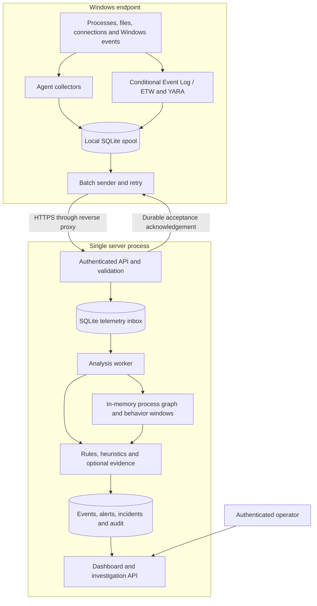
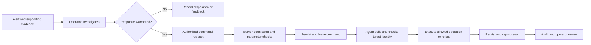
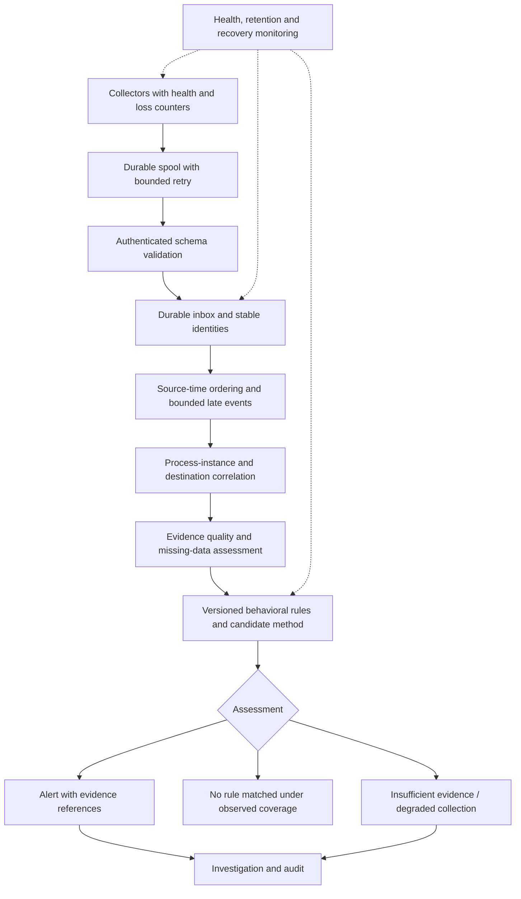
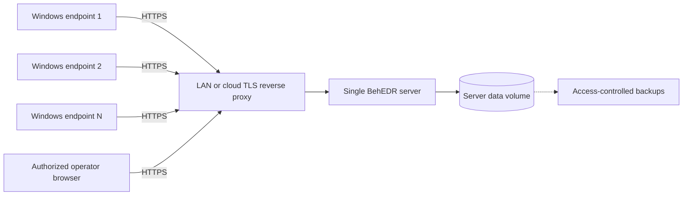
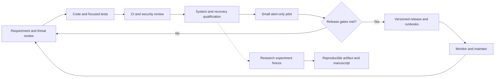

# BehEDR — Project Handbook, Architecture and SDLC Master Plan

> Historical plan (16 October 2026). Use [CURRENT_STATUS](../CURRENT_STATUS.md)
> for present implementation, deployment uncertainty and the R0–R9 completion roadmap.

**Project folder:** `C:\projects\newmalware`  
**Document date:** 16 October 2026  
**Purpose:** One consolidated reference for the existing implementation, known limitations, intended architecture, development and testing, research evaluation, and IEEE publication preparation.  
**Status:** Planning/documentation artifact. Creating this document does not implement the proposed fixes or validate deployment.

## Contents

1. [Purpose and present status](#1-purpose-and-present-status)
2. [Repository and component responsibilities](#2-repository-and-component-responsibilities)
3. [Feature inventory](#3-feature-inventory)
4. [Current architecture](#4-current-architecture)
5. [Operational workflows](#5-operational-workflows)
6. [Proposed architecture and data contracts](#6-proposed-architecture-and-data-contracts)
7. [LAN and cloud deployment](#7-lan-and-cloud-deployment)
8. [Security and privacy model](#8-security-and-privacy-model)
9. [Known defects and priority backlog](#9-known-defects-and-priority-backlog)
10. [Phase-wise SDLC](#10-phase-wise-sdlc)
11. [Test strategy and traceability](#11-test-strategy-and-traceability)
12. [Research and comparative evaluation](#12-research-and-comparative-evaluation)
13. [AI-assisted development workloads](#13-ai-assisted-development-workloads)
14. [IEEE publication plan](#14-ieee-publication-plan)
15. [Operations and release workflow](#15-operations-and-release-workflow)
16. [Milestones, ownership and immediate actions](#16-milestones-ownership-and-immediate-actions)
17. [Glossary and evidence sources](#17-glossary-and-evidence-sources)

## 1. Purpose and present status

BehEDR is a Windows endpoint telemetry and behavior-based threat-detection project with Python collectors, a server API, SQLite persistence, detection logic, and a browser dashboard. Its intended use is to collect observable activity, identify suspicious patterns, preserve supporting evidence, and help an operator investigate.

The central research topic remains **behavior-based malware detection**. AI-assisted development is one workload category for evaluation, not a replacement topic.

### Status vocabulary

- **Implemented:** code exists in the active application; this does not imply field validation.
- **Conditional:** depends on providers, permissions, dependencies, rules or configuration.
- **Disabled/reference:** present in the repository but not a supported active capability.
- **Proposed:** work in this plan that has not yet been implemented or verified.
- **Verified:** a particular check was performed with the scope stated below.

### Current assessment

| Question | Evidence-based answer |
|---|---|
| Does it detect suspicious behavior? | Implemented rules can emit alerts for selected patterns. |
| Is it a validated malware classifier? | No. Precision, recall, generalization and field false-alert burden remain unmeasured. |
| Does it detect every malware sample or zero-day? | No such evidence or guarantee exists. |
| Is it production-ready? | Not yet; correctness, security and operational gaps remain. |
| Is it ready for an IEEE detection-effectiveness paper? | Not yet; the contribution and reproducible experiments are incomplete. |
| Is all displayed data necessarily fake? | Live collection paths exist; regression tests use synthetic data. Actual deployment/UI behavior was not validated end to end in the review. |
| Is detection prevention? | No. An alert can occur after harmful actions; response does not undo damage. |

Prior subjective ratings: prototype **6/10**, production readiness **3/10**, publication readiness **3/10**. These are mentoring judgments, not measured accuracy or certification.

### Verified baseline from the 16 October review

- Regression suite: **63 passed in 30.33 seconds**, using a fresh project-local pytest temporary directory after Windows temporary-folder permission problems.
- Isolated checks of selected actual detector functions: five rapidly processed external HTTPS records returned a 70-point beaconing score; five ordinary document modifications including README.txt returned an 80-point ransom-note score.
- Isolated authentication check: deleting and recreating a viewer account allowed its original unexpired session again.
- Read-only database inspection: `backend/data/malware_hashes.db` contained zero rows in its malware-hash and statistics tables.
- These checks did not execute live malware, start collectors, perform destructive response, validate a deployed UI, or benchmark Wazuh/Fibratus.

This document consolidates those findings; it does not claim they were retested or fixed during document creation.

## 2. Repository and component responsibilities

```text
C:\projects\newmalware\
├── PROJECT_MASTER_PLAN.md       This consolidated handbook
├── README.md                    Existing setup and project overview
├── manage.py                    Server launcher and administration CLI
├── backend\server\
│   ├── __init__.py              Application factory and active blueprint wiring
│   ├── config.py                Environment configuration
│   ├── auth.py                  Users, sessions, endpoint credentials
│   ├── ingestion.py             Durable telemetry inbox and analysis dispatch
│   ├── commands.py              Supported response-command validation
│   ├── core\                   Detection, graph and optional model modules
│   ├── database\               SQLite storage and incident support
│   ├── routes\                 API and dashboard routes
│   ├── templates\              Dashboard HTML
│   └── static\                 Browser JavaScript and CSS
├── endpoint\                   Windows collectors, spool, response and service
├── rules\                      Behavioral rules and optional YARA directory
├── requirements\               Server, endpoint and development dependencies
├── tests\                      Isolated regression tests
├── deploy\                     Docker, Compose and Caddy configuration
├── tools\                      Maintenance utilities
├── docs\                       Operations, verification, evaluation and research
├── var\                        Local runtime state, not research source code
└── archive\                    Original snapshots; not the deployed application
```

Selected component mapping:

| Component | Main location | Responsibility |
|---|---|---|
| Agent lifecycle | `endpoint/agent.py`, `endpoint/agent_service.py` | Collect and transmit telemetry; console/service operation |
| Windows event collection | `endpoint/etw_consumer.py` and related helpers | Conditional event/provider ingestion |
| Local persistence | `endpoint/spool.py` | Buffer outbound records and command results |
| Endpoint response | `endpoint/response.py` | Validate and execute supported local operations |
| Ingestion | `backend/server/ingestion.py` | Validate/queue and dispatch accepted events |
| Behavioral logic | `backend/server/core/detector.py` | Rule/heuristic assessment and alerts |
| Process relationships | `backend/server/core/graph.py` | Process-instance graph context |
| Supplemental development context | `backend/server/core/development_guard.py` | Optional scoped policy assessment; not OS isolation |
| Web/API | `backend/server/routes/api.py` | Enrollment, telemetry, investigation, commands and health |

Avoid another structural rewrite solely for appearance. Place fixes in the existing components; introduce new modules only for clear responsibilities. Proposed research artifacts can later live under `research/protocols`, `research/manifests`, `research/configs`, `research/scripts` and `research/results`. Those folders are a proposal, not created by this handbook.

## 3. Feature inventory

| Feature group | Status | Limitation or next step |
|---|---|---|
| Process polling and command-line capture | Implemented | Short-lived/preexisting process coverage requires improvement |
| Event Log / ETW paths | Conditional | Provider/privilege requirements and restart gaps |
| Parent-child and process ancestry | Implemented | Out-of-order parents and state recovery incomplete |
| LOLBin, command-line and behavioral chains | Implemented | Authorized administration can resemble attacks |
| Lightweight sequence analysis | Implemented | Not a validated probabilistic malware model |
| Network behavior | Implemented | Arrival-time and process-name grouping defects |
| File/ransomware heuristics | Implemented | Unknown writer and broad filename rules |
| DLL checks and masquerading | Implemented/conditional | Coverage and exceptions need live testing |
| YARA | Conditional | Dependencies and rule quality determine coverage |
| Hash and IOC support | Conditional | Inspected hash DB empty; updater/path issues; IOC loading is separate |
| Experimental LSTM/GNN/autoencoder paths | Disabled/reference | Experimental ML is rejected by active configuration validation |
| Risk scores and MITRE labels | Implemented | Not calibrated probabilities or proof of compromise |
| Local spool and server inbox | Implemented | Recovery, capacity and retention need qualification |
| Dashboard, evidence and feedback | Implemented | Rendered end-to-end operation not verified in review |
| Roles, sessions, agent enrollment | Implemented | Account recreation session defect remains |
| Guarded response commands | Implemented | Requires operator authorization and process identity validation |
| Automatic containment and network isolation | Disabled | Do not advertise as active protection |
| External notifications and old Wazuh bridge | Disabled/reference | Not registered active application capabilities |
| UBA, memory forensics, active learning modules | Reference/unvalidated | File presence is not integration or effectiveness evidence |
| Containers/TLS configuration | Implemented configuration | Deployment and recovery still require qualification |

## 4. Current architecture

The diagram describes the intended active code paths, not a verified running deployment. Conditional collectors may produce no records when prerequisites are missing.



Plain-text equivalent: the endpoint observes activity, buffers records locally, sends authenticated batches, and removes acknowledged records according to spool handling. The server commits accepted records before analysis; a worker updates context and emits persisted alerts for investigation. An ingestion acknowledgement does **not** mean analysis completed or the endpoint was judged safe.

Important boundaries: database persistence does not make all correlation state durable; current graph/windows live in memory. Single-process operation is intentional in the current architecture. Adding workers without redesigning shared state can change detection behavior.

## 5. Operational workflows

### 5.1 Enrollment and identity

1. An administrator initializes server configuration and creates an administrator account.
2. The administrator enrolls a host ID, receiving a unique endpoint credential.
3. The endpoint is configured with the server URL, host ID, credential and local data directory.
4. The endpoint registers and sends heartbeats and telemetry.
5. Rotation/revocation changes credential validity; local secret storage still needs appropriate Windows ACLs.

No shared default administrator password is intended. Enrollment identity is not hardware attestation: a stolen credential or compromised endpoint can still submit misleading data within its granted identity.

### 5.2 Collection to alert

```mermaid
sequenceDiagram
    participant OS as Windows activity
    participant A as Agent
    participant S as Local spool
    participant API as Server API
    participant DB as Server database
    participant W as Analysis worker
    participant U as Operator dashboard
    OS->>A: Observable activity
    A->>S: Persist telemetry record
    A->>API: Authenticated batch
    API->>API: Validate identity and event schema
    API->>DB: Commit accepted records
    API-->>A: Acknowledge accepted event IDs
    A->>S: Remove acknowledged outbound records
    W->>DB: Read pending records
    W->>W: Normalize and analyze behavior
    W->>DB: Save findings and processing status
    U->>API: Request alerts and evidence
    API-->>U: Authorized results
    Note over A,API: Retry after network failure; acceptance is not a detection verdict
```

Example: a script process starts, opens a network connection and modifies files. Different collectors may record these observations. Current heuristics evaluate available evidence, and some paths correlate context. The proposed design will link them more reliably by process instance and event time. Do not assume the current file watcher identifies which process wrote a file.

### 5.3 Failure and retry

Network unavailable → retain records locally → retry when reachable → acknowledge durable server acceptance. Invalid records, capacity limits, analysis failures and collection gaps need visible states. Retry safety at the inbox identity level does not by itself prevent duplicate effects on in-memory analysis after a crash; this remains a qualification item.

### 5.4 Investigation and response

The active command set includes `collect_info`, `get_processes`, `get_network`, and guarded `kill_process`. Process termination requires PID, creation time and SHA-256 evidence. Automatic isolation is not enabled.



An acknowledged command is not necessarily a successful action. Report rejected, expired, failed and ambiguous outcomes distinctly. Server restore and command-ID reuse require correction. Do not claim unconditional exactly-once execution across arbitrary crashes.

### 5.5 API groups

| Purpose | Existing route examples |
|---|---|
| Operator identity | `/auth/login`, `/auth/me`, `/auth/logout`, `/auth/users` |
| Agent enrollment | `/api/agents/enroll`, `/api/agents/<system_id>/credential` |
| Agent lifecycle | `/register`, `/heartbeat` |
| Telemetry | `/events`, `/dll_events`, `/net_events`, `/file_events`, `/etw_events`, `/yara_hits` |
| Commands | `/api/command`, `/commands/<system_id>`, `/commands/result` |
| Investigation | `/api/events`, `/api/alerts`, `/api/incidents`, `/api/graph/<system_id>` |
| Audit and failures | `/api/audit`, `/api/analysis/failures` |
| Health/status | `/health`, `/ready`, `/api/status` |

Route existence is not a security guarantee; verify method, role and host checks in integration tests. Current readiness checks do not demonstrate complete collector/worker health.

## 6. Proposed architecture and data contracts

**Everything in this section is a target design unless explicitly present above.**



### Proposed event contract

| Field group | Intended meaning |
|---|---|
| `schema_version`, `event_id` | Versioned interpretation and stable deduplication |
| Host identity | Authenticated host identity; never accept arbitrary impersonation fields |
| `source_time`, `received_time` | Distinguish occurrence from server receipt; record clock uncertainty |
| Process identity | Host + boot/session identity where available + PID + creation time |
| Parent identity | Observed relationship with attribution provenance; unknown remains unknown |
| Event type and attributes | Process/file/network-specific validated fields |
| Source/provider | Collector and configuration version |
| Evidence quality | Missing fields, inferred attribution, gaps and collection state |
| Rule/model version | Reproduce a decision on the same input |

These field names are a proposed contract, not a claim that the API currently accepts them. Schema changes require migration and compatibility tests. Preserve raw source evidence separately from normalized fields when permitted; minimize sensitive data.

### Proposed alert contract

An alert should identify host, process instance if known, supporting event IDs, source-time range, receipt/analysis times, rule version, score semantics, reasons, evidence gaps and investigation disposition. A score is an ordering aid unless calibration is demonstrated. An unobserved event is not evidence of benignness.

## 7. LAN and cloud deployment

| Mode | Intended use | Required qualification |
|---|---|---|
| Single-machine lab | Development and safe fixtures | Isolated configuration; no misleading production claims |
| LAN pilot | Recommended first operational setting | HTTPS, host credentials, restricted administration, backups and health |
| Cloud-hosted server | Remote endpoints send telemetry over HTTPS | Additional exposure, privacy, capacity and access review |
| Enterprise/HA | Future scope | Shared state design, multi-node operation and measured recovery; not supported by current single-process assumptions |



The deployment location changes transport and administration, not detection novelty. The existing Compose configuration uses a non-root/read-only server arrangement and persistent volume, but the hash database path must be corrected and the deployment tested before claiming the entire application works under it.

## 8. Security and privacy model

### Assets and trust assumptions

Protect endpoint credentials, user sessions, command authority, event integrity, evidence availability, rule/update integrity and sensitive telemetry. The current design relies on the OS and collectors for observation; user-space telemetry cannot establish trustworthy evidence after arbitrary host compromise.

| Threat | Required control and test |
|---|---|
| Stolen endpoint credential | Host-bound authorization, rotation/revocation, anomaly monitoring; test cross-host submissions |
| Session replay | Non-repeating account/session identity; test deletion, recreation and revocation |
| Malicious telemetry | Strict schema/size limits, safe rendering, bounded processing; fuzz parsers and UI values |
| Command misuse | Server-side role checks, allowlisted actions, identity checks, expiry, audit and replay handling |
| Resource exhaustion | Bounded queues, rate/capacity controls and observable degraded state |
| Sensor disabled or log cleared | Health/gap detection; do not silently classify the host as safe |
| Compromised update/feed | Verified provenance, controlled updates, rollback and feed-health visibility |
| Backup theft | Restricted access, protected secrets and a documented encryption/key-management decision |
| Sensitive command lines/paths | Minimize/redact as appropriate; access controls, retention and deletion policy |

Authenticated transmission proves possession of a credential, not truth of the event. Separate collection failures from attacks and from benign activity. Policy context is not an OS sandbox. Prevention of prompt injection and static analysis of generated code are outside current detector guarantees.

Security requirements should be tracked against relevant [NIST SSDF](https://csrc.nist.gov/Projects/ssdf) practices and [OWASP ASVS](https://owasp.org/projects/asvs) checks for the web/API surface. Neither framework alone verifies the Windows sensor or malware accuracy.

## 9. Known defects and priority backlog

All items below are open planning items unless later evidence marks them resolved.

| ID | Priority | Finding | Fix and acceptance evidence |
|---|---|---|---|
| B01 | High | Recreated accounts accept old sessions | Immutable account identity/fresh session generation; lifecycle regression rejects old token |
| B02 | High | Processing-time beaconing and process-name grouping | Source-time/destination/process-instance handling; batch replay does not invent periodicity |
| B03 | High | README and unknown-writer ransomware overclaims | Corroboration and explicit attribution limits; benign bulk workloads tested |
| B04 | High | Collection gaps, IPv6, restart cursors and queue loss | Persistent bookmarks, verified Win32 calls, gap counters; controlled capture comparison |
| B05 | High | Empty hash DB and wrong persistence path | Configured volume, explicit population/update health; container and feed-failure tests |
| B06 | Medium | Lost graph context and repeated analysis effects | Defined recovery/replay semantics; crash and out-of-order tests |
| B07 | Medium | Distinct alerts suppressed by broad deduplication | Evidence-aware incident policy; distinct instances preserved |
| B08 | Medium | Command-ID collision after restore | Global command identity/server generation; restoration and replay tests |
| B09 | Medium | Incomplete operational health/retention | Worker/collector health, bounded retention, backup and load qualification |
| B10 | Research | Accuracy/novelty unestablished | Independent labels, fair baselines, related-work review and reproducible experiments |

Severity labels are local prioritization judgments, not externally assigned CVSS scores. The Win32 declaration concern is source-level and needs execution validation; do not report it as a reproduced crash.

## 10. Phase-wise SDLC

Security testing runs throughout development. Phases are dependency gates, not a reason to postpone security until the end.

### Phase 1 — Requirements and research definition

**Build:** software requirements, supported Windows matrix, target deployment envelope, privacy policy, threat scope, contribution statement and related-work matrix. Define acceptable latency, resource cost, alert burden and recovery targets before final evaluation.

**Functional/research checks:** every requirement has a measurable test; distinguish event, process, execution and incident labels. Verify closest methods before claiming novelty.

**Security checks:** asset inventory, role matrix, sensitive-data inventory and misuse cases.

**Output/gate:** reviewed requirements and traceability register; provisional research hypothesis. No arbitrary IEEE minimum accuracy is invented.

### Phase 2 — Architecture and threat model

**Build:** component contracts, trust boundaries, event identity, command lifecycle, schema migration, late-event policy, retention and recovery decisions.

**Functional checks:** walk through offline buffering, crash/retry, PID reuse and missing-parent scenarios.

**Security checks:** stolen token, malicious telemetry, unauthorized commands, log clearing and resource-exhaustion design review.

**Output/gate:** architecture decision records and explicit non-goals; no unsupported tamper-proof claim.

### Phase 3 — Reproducible engineering foundation

**Build:** source snapshot/version control, pinned dependencies, isolated test configuration, CI, artifact identity and build documentation. Separate fixtures from live runtime data.

**Functional checks:** clean-install build and regression suite on intended platforms; Windows APIs tested on Windows.

**Security checks:** secret scanning, dependency review, static analysis and protected release credentials. AI-generated changes receive the same review as other code.

**Output/gate:** clean checkout builds/tests reproducibly; historical test evidence is not presented as a new run.

### Phase 4 — Correct the baseline

**Build:** address B01–B03, B05, B07 and B08; specify score semantics and evidence wording.

**Functional checks:** batched HTTPS, benign README edits, concurrent process names, duplicate records, empty feeds and recreated users.

**Security checks:** revoked/expired sessions, role changes, host impersonation and stale commands.

**Output/gate:** known reproductions resolved with regression coverage. Preserve original behavior only as a diagnostic reference, not the sole research comparator.

### Phase 5 — Endpoint collection and spool

**Build:** persistent cursors, short-lived process coverage, IPv6, 64-bit API validation, source attribution, ACLs and loss/health counters.

**Functional checks:** create/exit/PID reuse, file rename/modify/delete, permission loss, service restart, log reset, offline recovery, queue capacity and full disk.

**Security checks:** unprivileged configuration/credential access, malformed fields and safe failure under missing privileges.

**Output/gate:** measured coverage and losses; collector failure becomes visible. Unknown attribution stays unknown.

### Phase 6 — Backend ingestion and recovery

**Build:** stronger schema validation, durable processing semantics, poison-record handling, retention, worker health and state reconstruction.

**Functional checks:** concurrent batches, duplicates, database lock, crash before/after acknowledgement, restart during analysis, storage exhaustion and restore.

**Security checks:** cross-host submission, revoked credential, oversized payload, injected strings, timestamp abuse and bounded load testing.

**Output/gate:** records and failures are traceable; retry/recovery guarantees are documented and tested.

### Phase 7 — Behavioral method

**Build:** candidate correlation mechanism with process identity, source time, independent signals, evidence quality and versioned rules. Implement component switches for ablations.

**Functional checks:** benign look-alikes, known behavior fixtures, deterministic replay and score bounds. Separate supplemental signatures from core behavioral results.

**Security checks:** misleading fields, pathological rule inputs, missing telemetry and bounded state growth.

**Output/gate:** algorithm specified and a feasible improvement beyond corrected baselines, or a recorded decision to revise the research question.

### Phase 8 — Dashboard, permissions and guarded response

**Build:** clear evidence/health states, server-enforced authorization, safe rendering, audited operator actions and unambiguous command results.

**Functional checks:** login/logout, pagination/filtering, empty states, incident status, feedback, command expiry and disappearing/reused target PID.

**Security checks:** CSRF, stored/reflected XSS, object-level authorization, privilege escalation, command injection and replay. Use disposable owned test processes for response tests.

**Output/gate:** unauthorized actions rejected; evidence is not executed as UI content; wrong-target commands fail safely.

### Phase 9 — Dataset and comparative evaluation

**Build:** independent ground truth, dataset manifests, task/host/time/family splits, baseline adapters and experiment scripts.

**Functional/research checks:** label quality, duplicates, leakage, reproduction, statistical grouping and fair baseline tuning.

**Security checks:** isolated malware lab, dummy secrets, controlled destinations, sanitized artifacts and dataset access controls.

**Output/gate:** frozen protocol and test set; reproducible results with uncertainty, failures and ablations.

### Phase 10 — System and security qualification

**Build:** release candidate, installer/upgrade path, rollback, backup/restore and operational documentation.

**Functional checks:** sustained load, bursts, soak testing, install/upgrade/uninstall, reconnect, service failure and recovery. Measure overhead during actual builds and backups.

**Security checks:** scoped integrated assessment of API, dashboard, local permissions, TLS, dependencies, update integrity and backup exposure; manually triage scanner findings and retest fixes.

**Output/gate:** no unresolved critical/high findings for pilot scope; lower risks have owners and treatment decisions; restore/rollback demonstrated.

### Phase 11 — Consenting operational pilot

**Build:** small Windows rollout in alert-only mode alongside existing protection; health monitoring, false-alert review and incident procedures.

**Functional checks:** daily collection health, resource cost, alert burden, controlled end-to-end test events, rotation and recovery drills.

**Security checks:** access review, audit inspection, credential revocation and privacy/retention operation.

**Output/gate:** declared operating targets met over an appropriate observation period. Benign pilot data does not establish malware recall.

### Phase 12 — Research release and IEEE submission

**Build:** manuscript, method/pseudocode, source snapshot, manifests, configurations and reproducible tables/figures.

**Checks:** independent reproduction, related-work accuracy, fair claims, figure/source provenance, disclosures and journal-specific requirements.

**Output/gate:** every numerical claim maps to evidence; unresolved limitations are disclosed. Submission is not acceptance or product certification.

### Phase 13 — Maintenance and vulnerability response

**Build:** dependency/rule updates, vulnerability reporting, support policy, credential incident handling and new holdout datasets.

**Checks:** regression and security tests on relevant changes; periodic restore exercises; performance/drift monitoring.

**Output/gate:** traceable releases and reviewed changes. Keep the published benchmark frozen rather than repeatedly tuning against it.

## 11. Test strategy and traceability

### Test layers

| Layer | Purpose | Example |
|---|---|---|
| Unit | Decision logic and boundaries | Token generation, interval calculation, parameter validation |
| Integration | Component contracts | Persist batch, retry, inspect status and alert evidence |
| Windows collection | Sensor correctness | Known process/file/network actions vs captured records |
| End-to-end | Real pipeline | Benign generated event through agent, server and dashboard |
| Security | Abuse resistance | Cross-host identity, XSS payload rendering, command authorization |
| Resilience | Failure semantics | Interrupted processing, full disk, restoration |
| Performance | Capacity envelope | Sustained/burst telemetry with latency and resource tracking |
| Detection evaluation | Scientific effectiveness | Labeled attacks/benign workload and fixed baselines |
| Acceptance | Operational usability | Operator investigation and incident runbook |

### Priority traceability examples

| Requirement | Functional test | Security/reliability test | Expected evidence |
|---|---|---|---|
| Session revocation persists | Delete and recreate account | Replay original token | Rejection without affecting new login |
| Host identity is bound | Submit valid host record | Use host A token with host B identity | Rejection or server-enforced correct identity |
| Delivery timing does not invent behavior | Replay identical events in batches | Delay/reorder and clock-error cases | Declared, explainable result differences only |
| Distinct instances stay distinct | Same name across PIDs/creation times | PID reuse before response | Correct attribution and wrong-target refusal |
| Duplicate transport is safe | Re-send stable event IDs | Crash and retry during analysis | No unintended evidence inflation |
| Dashboard treats evidence as data | Render unusual command line | Stored script markup | Text displayed without execution |
| Loss is visible | Fill queue or stop collector | Disable provider/log reset | Observable degraded health and counters |
| Restore preserves authority | Restore server state | Reuse old command identifier | Old actions do not execute as new commands |

Each test record should include requirement ID, environment/build, input provenance, expected result, observed result, logs/artifact path, reviewer and disposition. Use synthetic fixtures for deterministic regressions; do not present them as measured real-malware accuracy.

### CI cadence and definition of done

- Every relevant change: lint, unit/regression tests, dependency/secret checks and review.
- Sensitive changes: authentication, ingestion, response and migration integration tests plus security review.
- Scheduled: Windows collection, restart/replay, load and soak tests within available lab capacity.
- Research freeze: label/split audit, baseline fairness, reproducibility and result integrity.
- Release: system/security qualification and recovery evidence.

An item is done when its requirement, implementation, functional/security checks, evidence, documentation and residual risks agree. A green scanner or a coverage percentage alone is insufficient.

## 12. Research and comparative evaluation

### Recommended research question

Can a Windows behavioral detector retain attack recall and useful evidence while controlling false alerts under delayed/incomplete telemetry and legitimate high-volume activity?

Novelty is unresolved. Timing, provenance and uncertainty all have prior art. A specific method or substantial new empirical finding is required. Do not claim that fixing B02/B03 invents a new malware-detection technique.

### Experimental tracks

1. **Controlled replay:** same trace under delays, reordering, duplicates, clock error and random/contiguous loss. Suggested initial stress points: 0/1/10/60-second delays, a five-minute backlog burst and 0/1/5/10% loss. These are experimental proposals, not field statistics.
2. **Live isolated lab:** current Windows workloads with independent labels, malware where authorized, and separately reported emulations.
3. **Benign field pilot:** consenting ordinary work to measure false-alert burden, stability and overhead.

Use independent executions/hosts/days as statistical groups. Millions of related events are not millions of independent trials. Estimate sample size from pilot variability and required precision. Prevent duplicate-family/task/repository leakage between tuning and testing.

### Baselines and metrics

Compare corrected simple rules, corrected correlation without the candidate mechanism, the candidate method, and pinned Fibratus/Wazuh configurations. Add KAIROS/PIDSMaker only when schema, compute and detection-unit compatibility are established. Run equivalent-telemetry comparisons separately from complete product comparisons.

Primary measure: attack-execution recall at a declared false-alert budget. Also report precision, false alerts per endpoint-day, per-category results, PR curves where appropriate, attribution accuracy, decision coverage, latency, CPU/RAM/storage and telemetry loss. Report confidence intervals and paired comparisons where justified.

Measure latency from action to alert and receipt to alert separately. An offline endpoint cannot deliver an immediate server alert. Report abstained/insufficient-evidence cases rather than removing them from evaluation. Unknown malware-family holdouts do not establish universal zero-day protection.

### Competitor and related-work register

| Source | Relevance | Limit |
|---|---|---|
| [Fibratus](https://github.com/rabbitstack/fibratus) | Windows behavioral sensor and sequence rules | Closest operational comparison; existing correlation is prior art |
| [Wazuh](https://github.com/wazuh/wazuh) | Broader security/SIEM platform | Not signature-only; configuration/input coverage matters |
| [WHIDS](https://github.com/0xrawsec/whids) | Windows event detection and evidence collection | Documentation warns about beta drift |
| [Sigma](https://github.com/SigmaHQ/sigma) / [Chainsaw](https://github.com/WithSecureOpenSource/chainsaw) | Rule and offline hunting baselines | Specify engine; offline latency is not online latency |
| [CAPE](https://github.com/kevoreilly/CAPEv2) | Dynamic malware analysis | Sandbox, not the same continuous endpoint product |
| [HOLMES, IEEE S&P 2019](https://ieeexplore.ieee.org/document/8835390/) | Suspicious information-flow correlation | Conference prior work; abstract screened |
| [KAIROS, IEEE S&P 2024](https://spg.cs.ubc.ca/publication/2024-sp/) / [code](https://github.com/ubc-provenance/kairos) | Temporal graph detection/investigation | Selected full-text sections inspected; richer provenance assumptions |
| [Nip in the Bud, IEEE TDSC](https://ieeexplore.ieee.org/document/10638171/) | CTI-based forecasting/interpretation | Abstract screened; forecasting differs from current detection |
| [Graph-Based Anomaly APT Detection, IEEE TETC](https://ieeexplore.ieee.org/abstract/document/11410032/figures) | Graph learning and threat intelligence | Indexed abstract screened; full text not retrieved |
| [SIGL, USENIX 2021](https://www.usenix.org/conference/usenixsecurity21/presentation/han-xueyuan) | Installation-time behavioral analysis | Install/supply-chain detection is established |
| [Sometimes Simpler is Better, USENIX 2025](https://www.usenix.org/conference/usenixsecurity25/presentation/bilot) / [PIDSMaker](https://github.com/ubc-provenance/PIDSMaker) | Comparative methodology and practical limitations | Selected full-text sections inspected; pin exact paper/artifact version |
| [TESSERACT, USENIX 2019](https://www.usenix.org/conference/usenixsecurity19/presentation/pendlebury) | Time/distribution evaluation bias | Android study; methodological relevance rather than Windows coverage |
| [Atomic Red Team](https://github.com/redcanaryco/atomic-red-team) / [OpTC](https://github.com/FiveDirections/OpTC-data) | Test behaviors and public telemetry | Emulation/older telemetry are not current real-world malware populations |

Do not compare published accuracy numbers directly across incompatible datasets. Research so far is a targeted scoping review, not exhaustive coverage of all papers/repositories. Full-text and implementation validation remain required for formal novelty claims.

### Wazuh positioning

Wazuh offers broader documented fleet, integrity, vulnerability/configuration assessment and deployment capabilities. BehEDR is narrower and experimental. Neither project's accuracy superiority has been measured here. A useful research contribution does not require reproducing all Wazuh features, but it does require a fair comparison for the claimed capability.

## 13. AI-assisted development workloads

Evaluate manual development, conventional automation and AI-assisted development as separate strata. Pair comparable tasks such as dependency installation, builds, tests, refactoring, local server startup and authorized repository operations.

For harmful-behavior experiments, use synthetic secrets, disposable files and lab-controlled destinations. Record authorization separately from detector output. Record tool/model version, permission mode, repository revision, dependencies, task/prompt hash and repeat count. Agent runs can differ; preserve actual observations.

An AI-generated script is not automatically malware. A legitimate signed tool can perform harmful actions. Broad user permission is not proof that every downstream operation is intended. Process ancestry alone cannot establish prompt injection or user intent.

Relevant adjacent work includes [AgentDojo](https://arxiv.org/abs/2406.13352), [MalSkillBench](https://arxiv.org/abs/2606.07131) and [IssueTrojanBench](https://arxiv.org/abs/2607.20759). These were screened through author records/abstracts; peer-review venues were not verified in the scoping review. They are not evidence that BehEDR detects those scenarios.

For development of BehEDR itself, AI assistance does not replace review: inspect security-sensitive changes, verify dependencies and references, and independently validate test outcomes. Never manufacture results to complete a paper narrative.

## 14. IEEE publication plan

IEEE journals assess contribution, correctness and evidence; no universal minimum accuracy or product feature count exists. A research prototype can support a paper without being a production-certified endpoint product.

| Reviewer concern | Required artifact |
|---|---|
| Novelty | Precise comparison with closest methods |
| Correctness | Algorithm, assumptions and boundary cases |
| Validity | Independent labels, frozen splits and justified metrics |
| Fairness | Pinned baselines, comparable input and tuning budget |
| Practical relevance | Alert burden, latency, overhead and recovery evidence |
| Reproducibility | Versioned code/configurations/data manifests and scripts |
| Limitations | Missed behaviors, uncertainty and deployment boundaries |

Potential working title: **Evaluating Behavior-Based Malware Detection on Windows under Delayed Telemetry and High-Volume Benign Workloads**. Finalize after the experiments establish the contribution.

Candidate venue: IEEE Access for a rigorous applied study; consider TDSC/TIFS if the contribution supports their specialist scope. This is a provisional mentoring recommendation, not an acceptance prediction. Follow each venue's current requirements rather than treating IEEE as one journal.

Manuscript structure: problem/contributions → related work → threat model → method → implementation → dataset/protocol → results/ablations → limitations → conclusion. Prepare architecture and evidence-flow diagrams, workload tables, uncertainty-aware result plots, sensitivity curves and failure studies.

Submission gate: independent reproduction of representative results, verified references, appropriate attribution/licenses, authorship review, applicable AI-content disclosures, and one active submission venue at a time. Review official [criteria](https://ieeeaccess.ieee.org/reviewers/reviewer-guidelines/), [best practices](https://ieeeaccess.ieee.org/reviewers/reviewer-best-practices/), [submission guidance](https://ieeeaccess.ieee.org/authors/submission-guidelines/) and [reproducibility guidance](https://ieeeaccess.ieee.org/authors/reproducibility/) at submission time.

## 15. Operations and release workflow

### Setup reference

The following is the existing documented server setup, not a deployment executed while writing this file. Use an isolated environment until the known blockers are fixed.

```powershell
# Run from C:\projects\newmalware using the documented Python 3.12 environment.
python -m venv .venv
.\.venv\Scripts\python.exe -m pip install -r requirements/server.lock
.\.venv\Scripts\python.exe manage.py init
.\.venv\Scripts\python.exe manage.py create-user admin
.\.venv\Scripts\python.exe manage.py serve
```

`init` creates configuration with a random secret and refuses to overwrite an existing file. The administrator password is prompted. Production browser access requires the configured HTTPS reverse proxy; loopback development HTTP is a separate local-only configuration. Never copy actual secrets into this handbook or research artifacts.

Endpoint prerequisites/configuration include `EDR_SERVER_URL`, `EDR_SYSTEM_ID`, `EDR_API_KEY`, `EDR_AGENT_DATA` and, when needed, `EDR_TLS_CA_CERT`. Certificate verification is intended to remain enabled. Installation privileges, providers and service setup must be validated using the existing operations guide.

### Release process



### Required runbooks

- Collector stopped or provider unavailable: mark degraded, inspect permissions/logs, restore collection and record gap.
- Backlog growth: distinguish collection rate, transport and worker failures; preserve evidence and avoid silent drops.
- Credential compromise: revoke/rotate, inspect submissions/actions and preserve audit evidence.
- Incorrect alert: record analyst disposition and trace to rule/data version; tune on development data only.
- Server restore: verify database integrity, agent reconnect, command namespace, correlation recovery and retained credentials.
- Feed failure: expose stale/empty/unavailable status; behavioral operation must not imply fresh intelligence.
- Upgrade failure: roll back using tested compatible schema/configuration procedures.

Define retention, recovery time and recovery point targets for the intended deployment. Do not claim availability or capacity values until measured.

## 16. Milestones, ownership and immediate actions

| Milestone | Evidence | Meaning |
|---|---|---|
| M0: reviewed baseline | Existing review and test record | Defects known; not ready for broad deployment |
| M1: corrected laboratory release | B01–B08 fixes and meaningful tests | Suitable for controlled experiments within stated limits |
| M2: research freeze | Versioned method, datasets, baselines and results | Supports manuscript preparation |
| M3: pilot-qualified release | Security, recovery and operational evidence | Limited deployment envelope established |
| M4: publication submission | Complete manuscript/artifact and disclosures | Submission only; acceptance is external |
| M5: maintained operational release | Support, updates, vulnerability response and ongoing metrics | Scope-specific readiness, not universal protection |

Suggested roles: developer owns implementation and tests; security reviewer challenges trust boundaries; research lead owns protocol/labels; independent reproducer checks results; operator reviews deployment and alert usefulness. One person may cover several roles, but independent review is valuable for security and scientific claims.

A research-focused effort was previously estimated at 16–24 weeks under suitable lab access and supervision. This is a rough planning allowance, not a commitment for every SDLC phase or enterprise readiness. Re-estimate after requirements, data access and pilot feasibility are known.

Immediate order:

1. Preserve a versioned baseline and turn B01–B10 into tracked issues.
2. Define supported deployment and acceptance targets.
3. Resolve session correctness and misleading detection regressions.
4. Measure collector coverage and fix time/identity/recovery handling.
5. Specify the research method and compare with corrected simple logic and closest tools.
6. Freeze a protocol before collecting final headline results.

Deferred until justified: cloud HA, multi-tenancy, new deep models, automatic containment, broad platform support and extra dashboards. Adding scope before correctness and evidence increases work without necessarily improving the paper.

## 17. Glossary and evidence sources

| Term | Meaning in this project |
|---|---|
| Telemetry | Recorded observations; not automatically trustworthy ground truth |
| Behavioral rule | A condition on observed actions or sequences |
| Provenance | Relationships between actions/entities; partial ancestry is not whole-system provenance |
| Ground truth | Independently established outcome/label used to evaluate detection |
| False positive | Benign activity incorrectly classified under the predefined labeling unit |
| False negative | A labeled malicious execution/behavior missed under the protocol |
| Ablation | Removing a component to measure its contribution |
| Drift | Workload/distribution changes that can alter detector performance |
| EDR | Endpoint detection and response; a category, not a certification |
| SDLC | Software development life cycle, including maintenance and security |

Local supporting documents, available independently of this consolidated handbook:

- [README](C:/projects/newmalware/README.md)
- [Implementation details](C:/projects/newmalware/docs/implementation.md)
- [Operations](C:/projects/newmalware/docs/operations.md)
- [Migration](C:/projects/newmalware/docs/migration.md)
- [Historical verification](C:/projects/newmalware/docs/verification.md)
- [Development-tool monitoring](C:/projects/newmalware/docs/development-tool-monitoring.md)
- [Code evaluation, 16 October 2026](C:/projects/newmalware/docs/evaluation-2026-10-16.md)
- [Phase 1 research, 16 October 2026](C:/projects/newmalware/docs/phase-1-research-2026-10-16.md)

Additional official references: [Wazuh malware detection](https://documentation.wazuh.com/current/user-manual/capabilities/malware-detection/index.html), [Wazuh architecture](https://documentation.wazuh.com/current/getting-started/architecture.html), [TDSC topics](https://www.computer.org/digital-library/journals/tq/tdsc-topics), [IEEE Access scope](https://ieeeaccess.ieee.org/about/).

Maintain this handbook with each release: date observations, mark resolved backlog items only with evidence, identify implemented versus proposed changes, and update references before manuscript submission. No code fixes, malware execution or publication submission were performed as part of creating this document.
