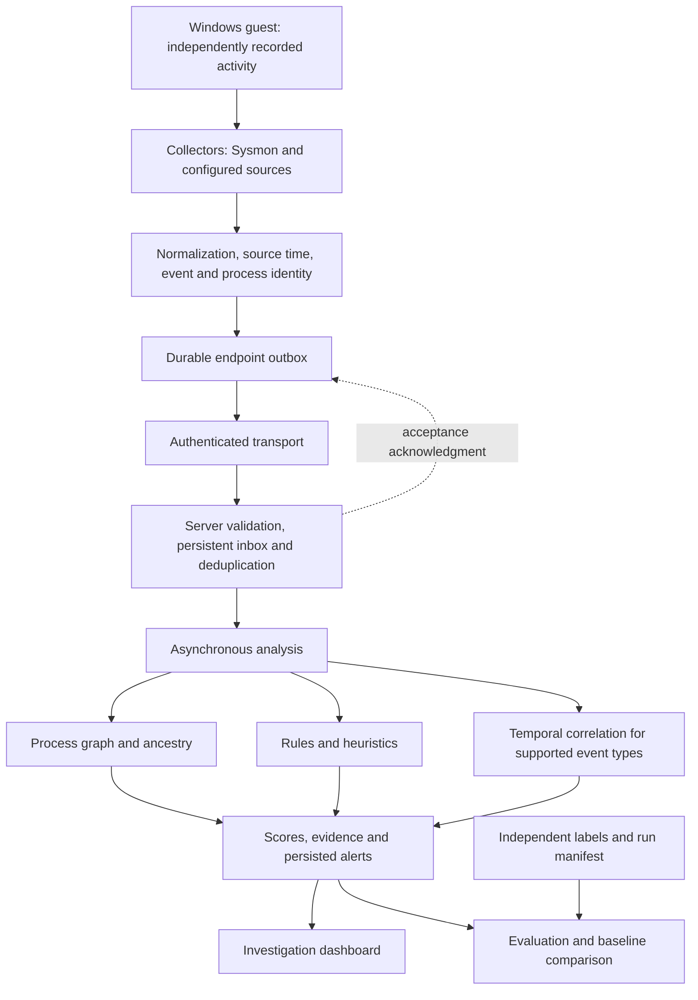

# BehEDR: publication, paper correction and malware evaluation plan

Prepared: **29 October 2026**. Status: **planning and evidence reconciliation, not a completed evaluation**.

## 1. Final verdict and scope

BehEDR is a behavioral endpoint detection research prototype. Its supported scope is rules, heuristics, process relationships and temporal correlation over collected telemetry. It is not currently a validated general malware classifier, malware-family attribution system or production-qualified EDR.

The next milestone is one frozen release with verified Windows-to-Linux delivery, independently labelled behavior tests, realistic benign workloads, a fair baseline and reproducible measurements. Adding ML, a kernel driver, Docker, an OVA or automatic containment is not a prerequisite for a focused research paper.

There is no universal IEEE feature checklist, scenario count, accuracy threshold or 9/10 score that guarantees acceptance. The specific venue and article type determine expectations. A credible contribution, sound methodology, clear limitations and claims supported by evidence are the goal.

This document consolidates the prior conversation, the earlier PDF review, local status records and a targeted source recheck. It does not claim an exhaustive new code audit. No tests, VM inspection, real malware execution or fresh accuracy experiment were performed to create it. Application code was not modified.

## 2. Evidence and current status

### Evidence reviewed

- Submitted PDF: `C:\Users\ASUS\Downloads\3yr implementation finalfinalist (2).pdf`. The earlier review inspected its text and figures. This plan reuses that review and the saved extraction in `tmp/pdfs/submitted-paper.txt`.
- [Current status](../CURRENT_STATUS.md), last updated 25 October 2026.
- [Verification results](../evidence/verification-2026-10-25.md), [guest verification workflow](../operations/verification-workflow.md), and [sender fix](../operations/sender-fix-2026-10-25.md).
- Targeted recheck of `backend/server/config.py`, `backend/server/core/sequence_heuristics.py`, `backend/server/ingestion.py`, `endpoint/spool.py` and `endpoint/transport.py`.

Use these labels throughout future reports:

| Label | Meaning |
|---|---|
| Implemented | Code exists and is reachable under stated prerequisites |
| Locally tested | Named checks passed on the recorded local environment |
| Live qualified | Installed guest versions and behavior were independently verified |
| Experimentally supported | A defined empirical study supports a bounded claim |
| Proposed | Planned work, not a present capability |

### Present capability register

| Capability | Current assessment | Remaining qualification |
|---|---|---|
| Sysmon process collection | Conditional implementation; polling fallback exists | Guest configuration, permissions, coverage and short-lived process capture |
| Other event/file/network observations | Source-dependent implementation | Attribution, scope and channel health; not complete endpoint visibility |
| Durable agent queue and server inbox | Implemented with acknowledgment/deduplication handling | End-to-end guest evidence and finite-capacity behavior |
| Sender route fairness | Source fix rotates queued routes while preserving per-route FIFO | Deployment and actual stalled-delivery incident diagnosis |
| Rules and behavioral heuristics | Active supported approach | Calibration and measured detection/false-alert performance |
| Process identity and ancestry | Stable identity where available; unresolved gaps retained | Live attribution correctness and edge cases |
| Temporal correlation | Event-time handling exists | Detector-specific timing behavior, late events and clock skew |
| Recovery | Graph/temporal journal and checkpoint support | Live restart qualification; do not generalize to every heuristic state |
| Sigma | Limited local subset | Not full Sigma compatibility or broad validated coverage |
| IOC/YARA | Optional/conditional paths | Provenance, usable corpus, updates and measured benefit |
| Dashboard and session hardening | Local implementation and regression evidence | Guest deployment, real data and usability verification |
| Response | Constrained operator-driven commands; auto response disabled | Live authorization/outcome checks; no network isolation claim |
| ML | Experimental ML is rejected by supported configuration | Exclude from active release claims |
| Legacy Wazuh bridge | Unsupported release capability | Exclude from contribution unless separately implemented and qualified |
| Native HTTPS/services | Deployment prototypes | Installation, startup, certificates, upgrades and recovery |

The previous full-suite record is **200 passed, 1 failed, 1 warning**. After correction, **21 targeted tests** passed; the sender-fix review recorded **28 targeted tests** passing. These sets overlap and must not be added. They do not constitute a fresh complete-suite result or a malware-accuracy benchmark.

The timeout trace to Windows `127.0.0.1:5000` demonstrates a missing timely HTTP response, not necessarily stopped collection. Distinguish collector failure, queue backlog, tunnel/network failure, server rejection and analysis delay. The route-starvation fix is a confirmed source defect repair, not proof of the live incident's sole cause.

### Historical review scores

These are subjective assessments from the preceding review, not new measurements or acceptance probabilities: paper **4/10**, research-prototype code **6.5/10**, empirical evidence **3/10**, production readiness **4/10**. Replace subjective scores with completion gates and measured outcomes below. Never report an aspirational 9/10 as an achieved result.

## 3. Submitted PDF: correction plan

The supplied PDF contains two report pages and five manuscript pages. Page references below use the full seven-page file. The user reports selection; no acceptance letter or venue-specific revision policy has been verified. A Turnitin AI-writing percentage does not validate research claims.

| Paper issue | Correction required |
|---|---|
| Title and contribution include active unsupervised ML | Align with the supported release or substantiate an exact historical implementation |
| Ten layers numbered L0–L10 | Eleven numbered components; use consistent stage names/counts |
| HIGH begins at 61 but ML cap 79 is described as below HIGH | Resolve threshold contradiction against the evaluated source |
| DLL score cap 90 described as avoiding CRITICAL at 85 | Correct threshold explanation |
| Sequential architecture versus reordered/conditional stages | Draw actual execution, dispatch and branch paths |
| In-memory dropping queue and four-worker analysis pool | Current release uses persistent delivery/inbox and one analysis worker; describe the chosen version |
| Shared endpoint API key | Explain current endpoint credential model if evaluating current code |
| Automatic isolation and bidirectional Wazuh integration | Remove unsupported capabilities from prose and figures |
| 13 adversary scenarios | Table contains 12 attack-labelled rows plus one normal row; distinguish denominators |
| 100% critical detection | Give exact successes/eligible cases and uncertainty; no general malware-recall inference |
| No benign alerts versus false positives below 3% | Give exact counts, exposure and denominator; avoid vague percentages |
| 12 ms called end-to-end latency | Receipt-to-alert excludes collection/transport; measure and name each interval |
| Throughput/capacity assertions | Supply load, hardware, duration, concurrency, backlog and raw evidence |
| Process spawning mapped to T1055 | Spawning is not proof of process injection; review all ATT&CK mappings |
| Broad competitor limitations | Replace categorical claims with sourced, version-specific comparisons |
| EMBER called a classifier | Correct its description as a dataset |
| WATSON bibliography year | Verify against official NDSS 2021 paper; resolve other mismatched references |
| Small architecture labels and report overlays | Produce clean vector diagrams and clean manuscript export |
| Grammar/repetition | Perform a full technical and language edit after results are frozen |

### Handling an already selected paper

1. Preserve the submitted PDF and any original implementation/evidence.
2. Ask the corresponding author or conference chair what substantial corrections are permitted before changing the title or central ML contribution.
3. Choose one defensible version: recover and substantiate the historical evaluated release, or revise around the current release with permitted changes and new experiments.
4. Never transfer old results to a new release without rerunning the relevant evaluation.
5. Do not enable unfinished ML simply to match the title. Do not invent or reconstruct missing measurements from memory.
6. If the required corrections cannot be accommodated, discuss the appropriate remedy with the venue rather than silently retaining unsupported claims.

Possible revised title, subject to scope and venue permission: **BehEDR: A Behavioral Endpoint Detection Prototype with Process-Aware Temporal Correlation**.

## 4. Research question and architecture

Proposed question: **Does process-aware temporal correlation improve detection of evaluated malicious behaviors over the same rules alone, particularly with delayed or incomplete telemetry, without excessive benign alerts?**

This is a hypothesis. Literature review and comparison must establish whether the proposed method contributes something beyond existing systems. Combining known components is not automatically methodological novelty. A rigorous systems evaluation may still contribute evidence about defined tradeoffs.

Separate detection improvement from delivery reliability: a durable queue can improve evidence availability without improving the intrinsic detector.



This is a conceptual supported-scope diagram, not a claim that every event traverses all stages or that acknowledgment means analysis completed. The publication figure must be traced against the frozen source. Describe health and recovery separately. Include no active ML or network-isolation boxes.

## 5. Malware terminology and coverage

| Term | Meaning | Example |
|---|---|---|
| Type/category | Behavior or propagation class | Ransomware or worm |
| Family | Related code, lineage or characteristic functionality | WannaCry |
| Variant | Modified version within a family | Changed code/configuration |
| Sample | Individual artifact | File identified by SHA-256 |

Vendors may disagree on family names. Preserve the labelling source, date, confidence and conflicts. A majority of antivirus names is not automatically definitive ground truth.

| Category | Typical purpose or behavior |
|---|---|
| Ransomware | Encrypt or deny access to demand payment |
| Trojan | Present itself as legitimate/useful software |
| Worm | Self-propagate between systems |
| Virus | Infect other files/programs to propagate |
| Spyware/information stealer | Collect information such as credentials |
| Backdoor/malicious remote-access tool | Enable unauthorized control |
| Downloader/loader | Retrieve or launch additional components |
| Rootkit | Conceal activity or maintain privileged access |
| Wiper | Destroy data or disrupt system usability |
| Malicious cryptominer | Consume resources for unauthorized mining |
| Bot malware | Participate in attacker-controlled activity |

Categories overlap. Fileless describes an execution approach, not one family. This table is educational: it is **not BehEDR's validated detection coverage**.

### Is one family enough?

| Goal | Evidence scope |
|---|---|
| Pipeline demonstration | One bounded scenario may suffice |
| Detection of one sample | One sample supports only that observation |
| Reliable detection of one family | Diverse samples/variants, benign comparisons and explicit limits are needed |
| Family-specific research case study | Potentially defensible with contribution and rigorous evaluation |
| Broad malware detection | One family is insufficient |
| Unseen-family generalization | Entire families must be held out from tuning; one family cannot establish it |

Repeating one sample 100 times measures repeatability, not diversity. Changing filenames or hashes alone does not guarantee independent behavior. Do not confuse behavior detection with family identification.

## 6. Initial demonstration and lab boundaries

Start with **ransomware-like behavior emulation** using disposable test files. This matches existing file-event/correlation work but must be compared with benign bulk-file activity. It is not execution of a named ransomware family.

Demonstration sequence:

1. Record the release, configurations, VM snapshots and run ID.
2. Confirm collector health, timestamps, transport acknowledgments and analysis progress.
3. Independently record the responsible process and planned disposable-file operations.
4. Execute the approved non-destructive scenario.
5. Show collected evidence, correlation window, alert explanation and attribution gaps.
6. Run comparable benign copying, backup-like activity or builds.
7. Repeat with delayed delivery, missing evidence and restart conditions.
8. Report both successful and unsuccessful cases. Retain evidence even if no alert appears.

Allowed presentation wording: “BehEDR detected the evaluated suspicious behavior and linked it to the observed process,” only where evidence supports attribution. Otherwise say attribution was unresolved.

Do not claim a family was identified, all ransomware is detected, encryption was prevented, or data was protected merely because an alert appeared. EICAR tests a supported antivirus test-signature path, not behavioral ransomware coverage.

Use the Windows 10 guest for controlled activity and Linux guest for the server; Windows 11 is the operator host. No Docker or OVA is required. Verify actual addresses instead of reusing historical IPs. SSH is one transport arrangement, not a detection dependency; qualify direct HTTPS separately if chosen.

If actual malware is later necessary, use a separately reviewed isolated lab with snapshots, no personal credentials, no host shared folders/clipboard and controlled network access. NAT alone is not isolation. Do not execute live malware on the daily-use host or use it for a public live demonstration. Confirm sample execution independently: a file that never ran is not a detector success or automatically a detector miss. Record AV blocking and environmental failures separately.

## 7. What to retain, defer and exclude

**Retain:** supported behavior rules, event identity, explicit unknown attribution, temporal correlation, durable delivery, health diagnostics, evidence-linked alerts, reproducible evaluation tooling and constrained operator actions where needed.

**Repair/qualify first:** live transport, installed-version identity, Sysmon collection, route fairness, timing semantics per detector, restart recovery, queue limits and trustworthy dashboard health.

**Defer unless the research question needs them:** ML, automatic containment, network isolation, custom kernel drivers, large integration catalogues, fleet-scale storage replacement, Docker and appliance packaging.

**Exclude from paper claims until demonstrated:** broad malware-family recognition, zero-day detection, tamper-proof protection, complete telemetry, automatic prevention, supported Wazuh bridge, enterprise scale and universal detection percentages.

Preserve historical code/evidence. Isolate unused experiments only after dependency review; do not delete reference material or functioning capabilities merely to simplify the narrative.

## 8. Phased development and qualification plan

The following phases are new completion gates, not assertions that earlier phases were completed. Owner defaults to the researcher/developer; independent labelling and manuscript review should involve a supervisor or second reviewer where feasible.

| Phase | Work | Tests and evidence | Exit gate |
|---|---|---|---|
| P0: scope and claims | Select venue/article type; reconcile PDF; define research question and capability matrix | Every claim linked to source/evidence or marked unverified | Approved scope and manuscript correction list |
| P1: freeze and transport | Identify packages; deploy sender repair; qualify configured network route | Normal delivery, per-route failure, lost acknowledgment, reconnect, agent/server restart, invalid acknowledgment | Counts reconciled; every missing/duplicate event explained; no hidden starvation in stated tests |
| P2: collection | Qualify Sysmon primary source; label fallback; document source/receipt time and identity | Short-lived processes, parent order, permissions, rollover, reboot, collector crash, queue exhaustion | Independently measured coverage and explicit gaps |
| P3: detector contracts | Trace active stages; keep severity separate from probability; verify unknown attribution | Positive, benign lookalike, missing identity, skew, out-of-order and expired-window cases | Regression-covered contracts and accurate architecture |
| P4: live investigation | Install correct console; show queue age, collector health and analysis progress | Viewer/analyst/admin roles, stale state, logout/expiry, late responses, hostile text, keyboard/mobile | No false health or inferred command success |
| P5: deployment/security | Qualify one non-Docker installation; protect secrets; document backup/rollback | Restart/startup, auth boundaries, malformed input, resource limits, storage pressure, restore and upgrade interruption | Reproducible lab installation and documented security findings |
| P6: experimental protocol | Freeze scenarios, labels, tuning/held-out groups and alert matching | Integrity checks, duplicate/split leakage checks, execution verification | Protocol fixed before held-out evaluation |
| P7: comparison | Run rules-only, full system, ablations and one external baseline | Identical eligible traces for detector comparison; separate sensor comparisons | Reproducible metrics with uncertainty and failure cases |
| P8: manuscript | Rewrite title/abstract/method/results/limitations; redraw diagrams | Claim audit, bibliography audit, figure readability and clean PDF | All numbers trace to frozen evidence; permitted venue revisions |
| P9: reproduction/review | Package sanitized code/configs/scripts; obtain independent rerun/review | Clean installation and regenerated tables; inspect secrets/licences | Shareable evidence bundle and scoped conclusions |

Production qualification is a separate extension: sustained consenting pilot, operational limits, independent security review and supported maintenance lifecycle. It is not implied by publication.

## 9. Experimental design

### Conditions to compare

- B0: corrected rules-only BehEDR using the same eligible input.
- B1: full supported BehEDR.
- A1: full system with ancestry contribution disabled.
- A2: full system with temporal correlation disabled.
- E0: one external baseline, initially a documented Sysmon + Sigma execution pipeline.

Verify switches actually change the intended execution path. Hold unrelated thresholds and input fixed. Document interactions: disabling a feature may change downstream scoring, so an ablation needs a precise definition. Configure baseline rules reasonably using tuning data and explain unmatched coverage. Do not equate absence of an equivalent baseline rule with algorithmic superiority.

### Scenario matrix

| Scenario group | Positive/emulated activity | Benign comparison | Perturbation |
|---|---|---|---|
| File activity | Defined suspicious disposable-file sequence | Copy/build/backup-like batch activity | Missing writer, delayed batches, slow activity |
| Process chain | Approved suspicious parent/child sequence | Installer and administrator process trees | Short-lived child, parent arriving late, PID reuse |
| Persistence-related | Approved controlled behavior only if supported | Legitimate installer/configuration activity | Missing channel or partial evidence |
| Network timing | Controlled test connections to a lab service | Periodic legitimate service traffic | Jitter, gaps, reconnect and clock skew |
| Recovery | Replay of pending labelled activity | Ordinary idle/background traffic | Lost response, restart, queue pressure |

These are planned groups, not validated coverage. Eligibility depends on actual collector/detector support. No fabricated telemetry should be mixed with real endpoint captures without explicit labels.

### Splits and ground truth

Separate implementation regression fixtures, tuning runs and held-out evaluation. Group related samples, repeated runs and near-duplicate traces so they do not leak across splits. Use family holdout only for family-generalization claims. Labels must come from scenario execution records and independent observations, not BehEDR's own alerts. Record execution failure, AV interference, environmental failure and inconclusive outcomes; publish their counts and predefine how they affect denominators.

Begin with a pilot to estimate variance and false-alert frequency, then choose final exposure and repetitions before evaluation. There is no IEEE-mandated sample count. A short benign run or one attack family cannot justify broad operational claims.

## 10. Metrics and measurement rules

| Metric | Definition and cautions |
|---|---|
| Scenario recall | Detected eligible positive runs / all eligible positive runs; predefine matching window |
| Precision | True-positive counted alerts / all counted alerts; disclose test prevalence and deduplication |
| False-alert burden | False alerts / benign endpoint-hour or endpoint-day; report numerator and exposure |
| FPR, if used | FP / (FP + TN) only with a meaningful predefined negative unit; do not use event count opportunistically |
| Collection coverage | Independently expected observable events captured / expected observable events |
| End-to-end latency | Alert persistence time minus source activity time, with clock-sync uncertainty |
| Analysis latency | Alert time minus server receipt time; report separately from collection/transport |
| Attribution | Correct, incorrect and unresolved links; report correctness and coverage separately |
| Delivery/recovery | Unique accepted/processed IDs, duplicate submissions, rejected/lost/pending IDs and queue age |
| Resource cost | Agent/server CPU, memory, disk growth and backlog under specified workload |

Use medians, tail percentiles and uncertainty where supported by sample size. Report run/workload or sample-level dependence; do not treat correlated events as independent observations. Zero false alerts in a small run does not establish a zero real-world false-alert rate. A rule score is not a calibrated malware probability.

Suggested run record: run ID, split, scenario/sample ID, label source, expected observations, execution status, OS/Sysmon version, package/config/rule hashes, start/end times, clock offset, capture counts, queue before/after, accepted/processed IDs, alerts, attribution, latency, resources and failure notes.

## 11. Security test checklist

- [ ] Endpoint credentials cannot submit as another endpoint or access unrelated data.
- [ ] Viewer/analyst/admin boundaries match documented permissions.
- [ ] Account recreation, revocation and session expiry cannot revive old authorization.
- [ ] Logout clears identity/evidence/token UI state; late responses cannot repopulate it.
- [ ] Hostile event strings render as text, not executable dashboard content.
- [ ] Oversized/malformed batches, replay and resource pressure have bounded behavior.
- [ ] Command authorization, expiry and process identity are enforced; no inferred success.
- [ ] TLS verification and credentials are handled correctly for the selected installation.
- [ ] Backups/restores preserve intended identity semantics without exposing secrets.
- [ ] Interrupted updates and storage exhaustion preserve diagnosable state.
- [ ] Dependencies and imported rules have pinned provenance and licence records.

Passing this checklist supports the tested boundaries; it is not an independent security certification.

## 12. Publication structure and evidence bundle

Recommended manuscript structure:

1. Abstract: problem, contribution, evaluated scope and measured results only.
2. Introduction: research question and specific contribution.
3. Related work: feature/telemetry/method comparisons supported by sources.
4. Threat model and assumptions: OS, privileges, sensor scope and adversary limitations.
5. Design: actual contracts, identity, time, correlation and delivery semantics.
6. Implementation: frozen versions, enabled detectors and relevant limits.
7. Evaluation: protocol, labels, splits, baselines, metrics and uncertainty.
8. Results and discussion: improvements, costs, failures and negative outcomes.
9. Limitations: lab scope, sample diversity, missing telemetry, admin tampering and deployment limits.
10. Reproducibility and conclusion: artifact access and conclusions bounded by evidence.

Proposed sanitized reproduction bundle (not created by this plan):

```text
research-release/
  README.md
  manifest.json
  configs/                 # sanitized sensor/server/agent/baseline configuration
  scenarios/               # definitions, expected observations, execution metadata
  labels/                  # provenance, split/group IDs, adjudication records
  evaluation/              # metric and table/figure generation scripts
  evidence/                # permitted sanitized traces, run summaries, hashes
  results/                 # generated metrics and uncertainty
  limitations.md
  licences-and-provenance.md
```

Do not publish `.env`, credentials, private runtime databases, personal command lines or malware binaries in an ordinary source release. Document any redactions and their reproducibility consequences. Preserve unredacted evidence securely where appropriate.

## 13. What is enough for each claim level?

| Level | Defensible output | Insufficient by itself |
|---|---|---|
| Demonstration | One repeatable behavior and benign comparison showing evidence flow | Screenshots or prefilled alerts |
| Focused case study | Narrow question, independent labels, varied conditions and limitations | One successful sample run |
| Research paper | Distinct contribution, fair baseline/ablations, reproducible evaluation and uncertainty | Feature count or polished dashboard |
| Broad detection claim | Representative behaviors/families/workloads and appropriate held-out evidence | One family or small simulation set |
| Production claim | Sustained deployment, security/maintenance/recovery qualification | Paper acceptance or unit tests |

Before submission/final revision:

- [ ] Target venue and allowed revision scope confirmed.
- [ ] Exact implementation and enabled rules identified.
- [ ] Live transport and collection qualified.
- [ ] Positive, negative and missing-evidence cases evaluated.
- [ ] Dataset/splits/labels independently defensible.
- [ ] Baseline and ablations complete, or claims narrowed with justification.
- [ ] Metrics reproducible; all failures and exclusions disclosed.
- [ ] Unsupported ML, integration, isolation and production claims removed.
- [ ] Figures, references, thresholds and scenario counts corrected.
- [ ] Clean manuscript and reproduction materials reviewed.

## 14. Sources and further reading

Official IEEE guidance was checked on 29 October 2026. General guidance does not replace the selected venue's author instructions. IEEE encourages sharing code, data and other research outputs for verification; venue requirements differ.

- [IEEE conference reproducibility](https://conferences.ieeeauthorcenter.ieee.org/write-your-paper/research-reproducibility/)
- [IEEE journal reproducibility](https://journals.ieeeauthorcenter.ieee.org/create-your-ieee-journal-article/research-reproducibility/)
- [IEEE reviewer considerations](https://journals.ieeeauthorcenter.ieee.org/submit-your-article-for-peer-review/become-an-ieee-reviewer/)
- [IEEE conference ethical requirements](https://conferences.ieeeauthorcenter.ieee.org/author-ethics/ethical-requirements/)
- [IEEE article structure](https://journals.ieeeauthorcenter.ieee.org/create-your-ieee-journal-article/create-the-text-of-your-article/structure-your-article/)
- [Microsoft malware naming](https://learn.microsoft.com/en-us/defender-xdr/malware-naming)
- [Microsoft malware overview](https://learn.microsoft.com/en-us/defender-endpoint/malware/understanding-malware)
- [Microsoft classification criteria](https://learn.microsoft.com/en-us/defender-xdr/criteria)
- [MITRE ATT&CK process injection](https://attack.mitre.org/techniques/T1055/)
- [Official WATSON paper, NDSS 2021](https://www.ndss-symposium.org/wp-content/uploads/2021-549-paper.pdf)

Immediate next action: identify the installed Windows/Linux package hashes, qualify the sender fix using the guest verification workflow, and save a reconciled run record before expanding detection coverage.
